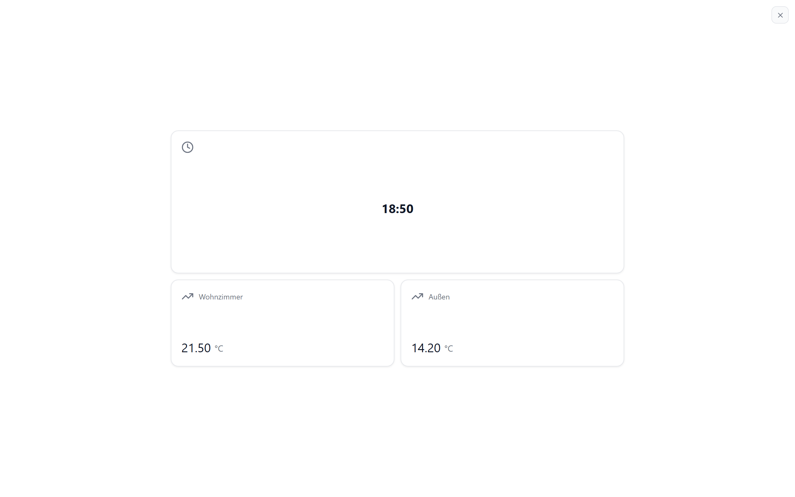
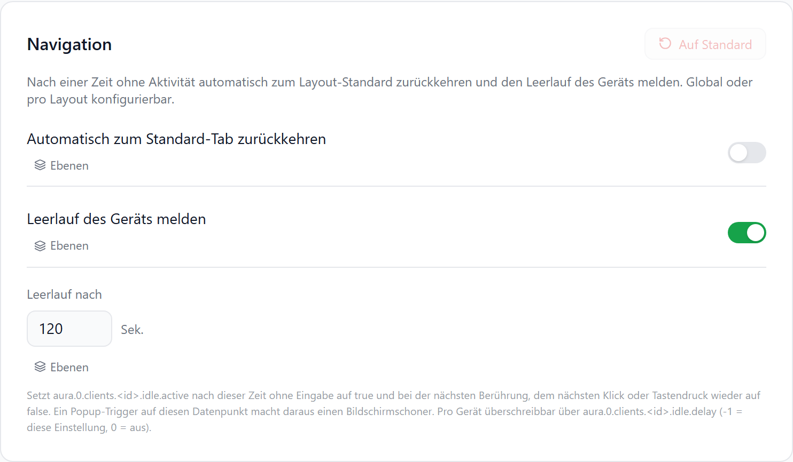
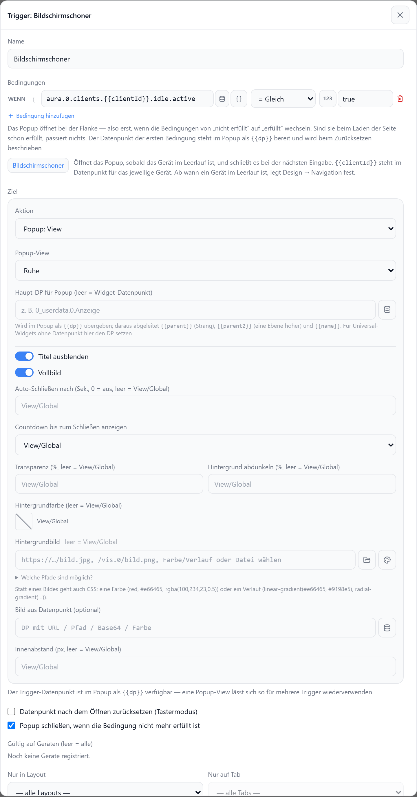

# Bildschirmschoner erstellen

Nach einer Zeit ohne Eingabe zeigt das Gerät eine Ruhe-Ansicht im Vollbild. Die nächste Berührung, Mausbewegung oder Taste schließt sie, und der vorherige Bereich steht unverändert darunter.



## 1. Leerlauf-Zeit festlegen

**Admin → Frontend-Design → Navigation → Leerlauf des Geräts melden**



| Option | |
| --- | --- |
| Leerlauf des Geräts melden | An (Standard) |
| Leerlauf nach | Sekunden ohne Eingabe, Standard `120` |
| Ebene | Global, pro Layout oder pro Bereich |

Jedes Gerät meldet seinen Zustand in `aura.0.clients.<ID>.idle.active` (`true` / `false`).

## 2. Ruhe-Ansicht anlegen

**Admin → Popups → Popup-Views → View hinzufügen**, z. B. „Ruhe“ — mit Uhr, Wetter, Temperaturen.

## 3. Trigger anlegen

**Admin → Popups → Popup per Datenpunkt → Trigger hinzufügen → Bearbeiten**



| Schritt | |
| --- | --- |
| Knopf **Bildschirmschoner** | Setzt die Bedingung `aura.0.clients.{{clientId}}.idle.active` = `true` und „Popup schließen, wenn die Bedingungen nicht mehr erfüllt sind“ |
| Aktion | `Popup: View` |
| Popup-View | Die Ruhe-Ansicht aus Schritt 2 |
| Titel ausblenden | An |
| Vollbild | An — ganzer Bildschirm ohne Rand und Rahmen |
| Gültig auf Geräten | Optional, z. B. nur das Wandtablet; leer = alle |
| Nur in Layout / Nur auf Tab | Optional |

`{{clientId}}` steht für das Gerät, auf dem das Dashboard läuft — ein Trigger reicht für alle Geräte.

## Pro Gerät abweichend

| Datenpunkt | |
| --- | --- |
| `aura.0.clients.<ID>.idle.delay` | `-1` = Einstellung aus Schritt 1, `0` = aus, sonst Sekunden |

```js
// Wandtablet: Bildschirmschoner nach 5 Minuten
setState('aura.0.clients.wandtablet.idle.delay', 300);
```

::: tip Fotos als Bildschirmschoner
Eine [Diashow](../widgets/diashow#als-bildschirmschoner) als einziges Widget der Ruhe-Ansicht macht das Tablet zum Bilderrahmen.
:::

::: tip Vollbild-Widgets
Ein Video oder eine Kamera im Vollbild zählt ohne Eingabe ebenfalls als Leerlauf. Trigger bei Bedarf mit **Nur auf Tab** einschränken.
:::

Siehe auch: [Popup per Datenpunkt](../einstellungen/popups#popup-per-datenpunkt), [Leerlauf-Datenpunkte](../einstellungen/settings#leerlauf).
