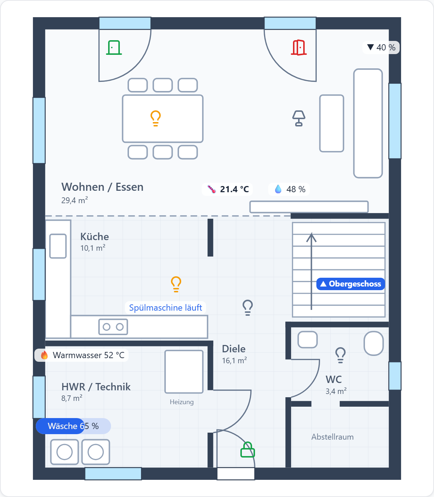
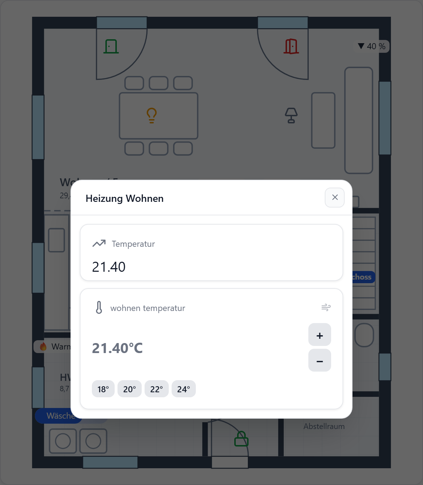

# Grundriss mit Bedienelementen

Ein Grundriss als Bild, darauf Lampen, Temperaturen, Türen und Rollläden an ihrer Stelle im Raum. Ein Klick öffnet das passende Bedien-Popup.

## 1. Grundriss vorbereiten

| | |
| --- | --- |
| Zuschnitt | Bis an die Außenwände, ohne weißen Rand und Maßangaben |
| Format | PNG, JPG oder SVG |
| Vorlage | [grundriss-eg.svg](./assets/grundriss-eg.svg) — gezeichnet auf ein 20×20-Raster, eine Zelle = 40 × 50 Einheiten |

Bildquellen (Datei, URL, Adapter-Pfad, Base64): siehe [Bildpfade](../widgets/bildpfade).

## 2. Widget und Raster

**Editor → Widget hinzufügen → Bild → Bearbeiten → Layout: Custom**

| Einstellung | Wert |
| --- | --- |
| Spalten · Zeilen | `20` · `20` — je feiner, desto genauer sitzen die Elemente |
| Zelle oben links | Typ `image`, Bild aus Schritt 1 |
| Spaltenbreite · Zeilenhöhe | `20` · `20` — das Bild liegt unter dem ganzen Raster |
| Darstellung | **Strecken** — das Bild folgt dem Raster bei jeder Widget-Größe |
| Titel · Icon | aus |

Seitenverhältnis des Widgets ungefähr wie das Bild ziehen, sonst wird es gestreckt.

## 3. Elemente auf den Plan setzen

Jede Zelle, die auf dem Bild liegt, wird darüber gezeichnet. Zelle anklicken, Typ wählen, Datenpunkt eintragen.

| Im Beispiel | Zelltyp | Einstellungen |
| --- | --- | --- |
| Lampe | `state-icon` | Icon `Lightbulb`, Farbe an `#f59e0b` / aus `#64748b`, Größe `24` |
| Dimmer-Lampe | `state-icon` | Zustand **Bedingung** `> 0` — sonst gilt nur `true`/`1` als an |
| Terrassentür | `state-icon` | `DoorOpen` rot / `DoorClosed` grün |
| Temperatur · Feuchte | `dp` | Präfix `🌡 ` / `💧 `, Suffix ` °C` / ` %`, Hintergrund `#ffffffd9` **Nur hinter dem Inhalt** |
| Spülmaschine | `state-text` | Text an „läuft“ / aus „fertig“ |
| Waschmaschine | `progress` | 0–100, Wert anzeigen, Präfix `Wäsche ` |
| Haustür | `switch` | Darstellung **Icon** `Lock` / `LockOpen`, **Sicherheitsabfrage** an |
| Stockwerk | `text` | „▲ Obergeschoss“, Hintergrund blau, nur hinter dem Inhalt |

Spaltenbreite `2`–`5` gibt Beschriftungen Platz und vergrößert die Klickfläche.

## 4. Klick-Aktionen

**Zell-Editor → Klick-Aktion**

| Element | Aktion | |
| --- | --- | --- |
| Lampe | Popup: Schalter | |
| Dimmer-Lampe | Popup: Dimmer | |
| Rollladen „▼ 40 %“ | Popup: Rollladen | |
| Temperatur | Popup: Thermostat | Solltemperatur-Datenpunkt angeben |
| „▲ Obergeschoss“ | Link: Tab | Tab mit dem Grundriss des Obergeschosses |
| Haustür | — | `switch`-Zelle schaltet selbst, fragt vorher nach |

Popup-Titel pro Zelle im Klick-Aktion-Dialog, z. B. „Heizung Wohnen“.

## Beispiel importieren

[grundriss-widget.json](./assets/grundriss-widget.json) — das Widget von oben, Grundriss eingebettet.

1. Editor → **Importieren** → JSON einfügen → Tab wählen → **Hinzufügen**.
2. Datenpunkte `demo.0.eg.*` durch eigene ersetzen.
3. „▲ Obergeschoss“ → Klick-Aktion → Ziel-Tab wählen.
4. Eigenen Grundriss in die Zelle oben links laden.

Siehe auch: [Custom-Layout](../widgets/custom-layout), [Klick-Aktion je Zelle](../widgets/custom-layout#klick-aktion).
