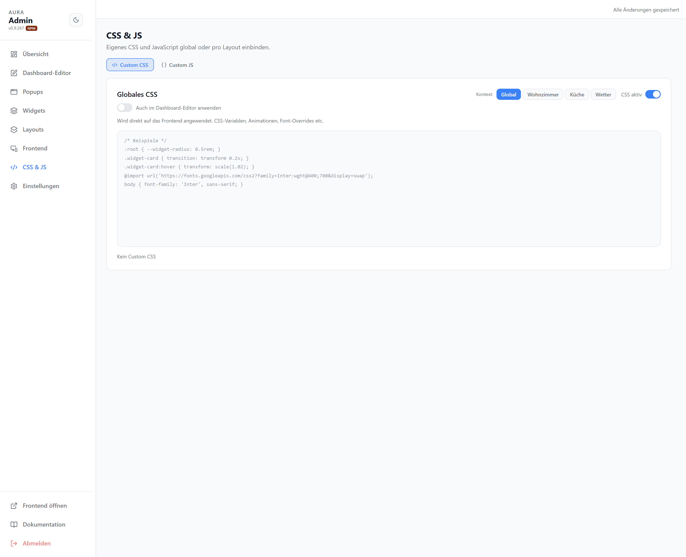
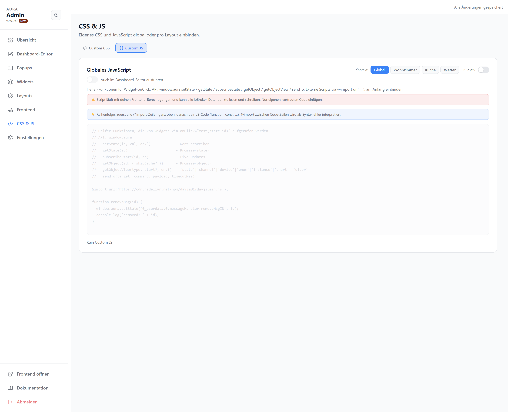

# CSS & JS

Eigenes CSS und JavaScript global oder pro Layout einbinden (Geltungsbereich oben rechts).

## Custom CSS



Überschreibt Theme-Variablen und Widget-Styles per CSS.

| Selektor | trifft |
| --- | --- |
| `.aura-tabs` | Tab-Leiste, oben wie unten |
| `.aura-tabs-top` | Tab-Leiste über dem Dashboard |
| `.aura-tabs-bottom` | Tab-Leiste als Fußzeile |
| `.aura-widget-type-<typ>` | alle Widgets eines Typs |
| `.aura-widget-title` · `.aura-widget-icon` · `.aura-widget-value` | Titel, Icon, Wert in jedem Widget |

```css
.aura-tabs-bottom {
    padding-bottom: calc(12px + env(safe-area-inset-bottom));
}
```

Alle Selektoren: [CSS-Klassen](./css-klassen). Farben und Maße besser über [Design-Tokens](./design-tokens).

## Custom JS



JavaScript läuft mit den Frontend-Berechtigungen und kann ioBroker-Datenpunkte lesen und schreiben. API über `window.aura`:

| Funktion | |
| --- | --- |
| `setState(id, val, ack?)` | Wert schreiben |
| `getState(id)` | aktuellen Wert lesen |
| `subscribeState(id, cb)` | Live-Updates abonnieren |
| `getObject(id)` | Objektdefinition lesen |
| `sendTo(target, command, payload, timeoutMs?)` | Adapter-Nachricht senden |
| `registerFn(name, fn)` | Funktion für `callback("name", dp)` in der [Wert-Umrechnung der Listen](../widgets/liste#eigene-funktionen) anmelden |
| `unregisterFn(name)` | Funktion wieder abmelden |

Bis auf `registerFn`/`unregisterFn` stehen dieselben Funktionen ohne Custom JS im [HTML-Widget](../widgets/html#datenpunkte-schreiben) und im
`htmlTemplate` der [Wert-Anzeige](../widgets/wert-anzeige) bereit.

Externe Skripte über `@import url('…');` am Anfang einbinden.
