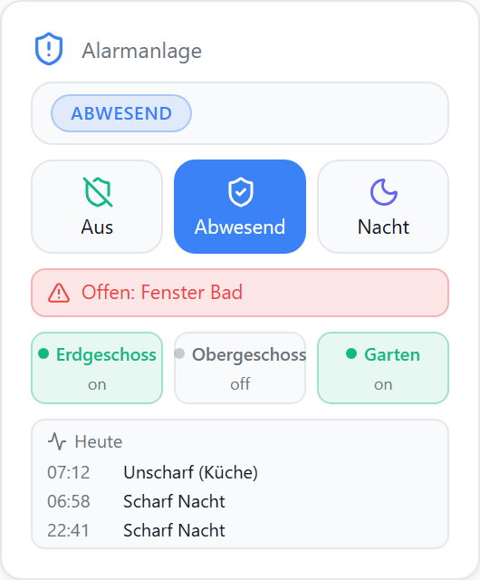
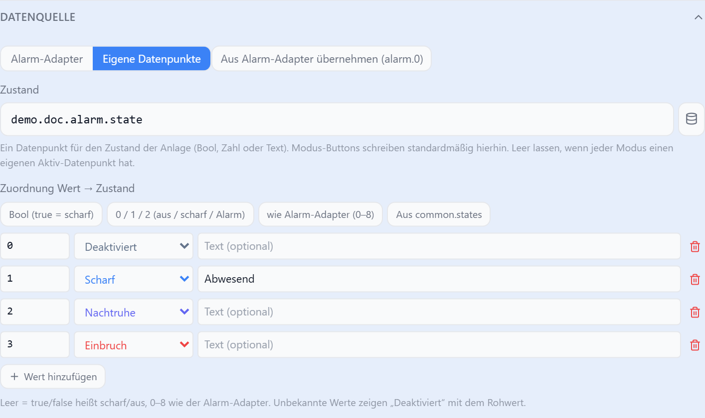
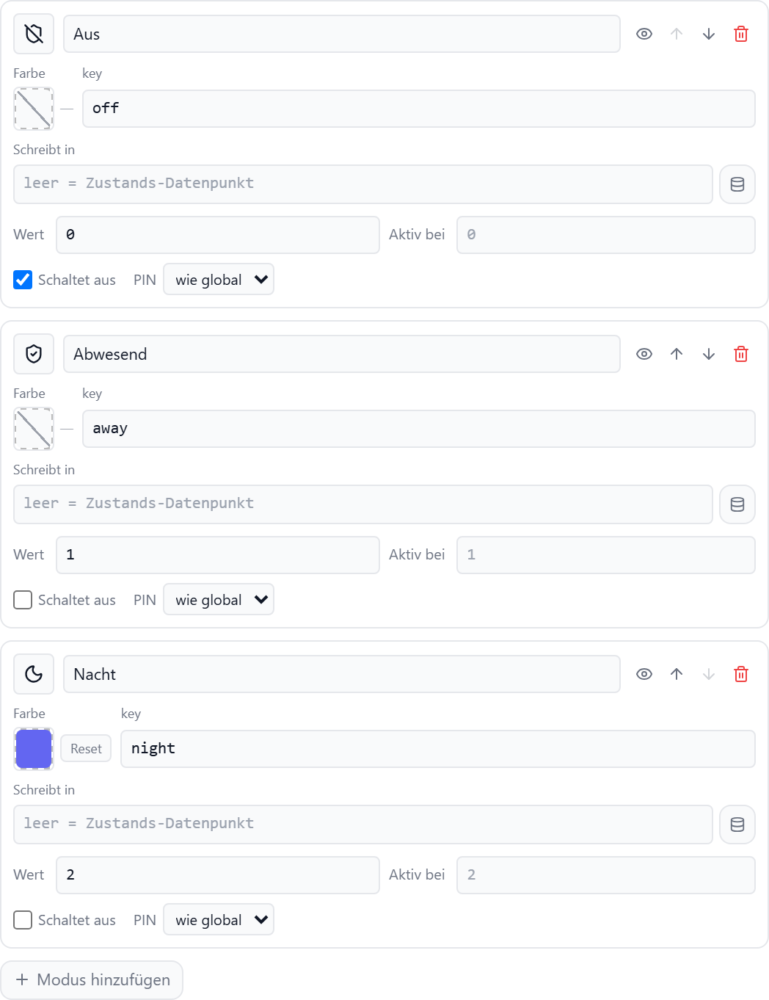
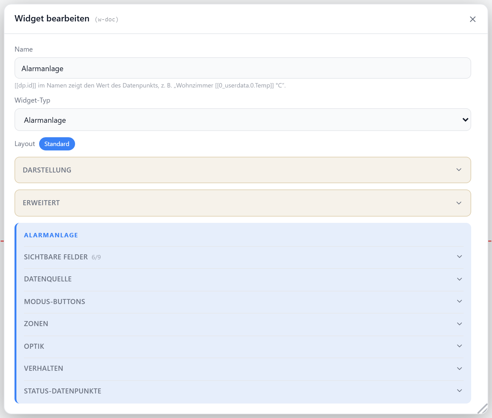

# Alarmanlage

Steuert eine Alarmanlage: Scharf, Innen-Scharf und Nachtruhe schalten, Zonen ein-/ausschalten, bei Alarm per PIN entschärfen sowie das heutige Ereignis-Log anzeigen. Bei Einbruch/Stiller Alarm pulsiert die Statuskarte rot.

Zwei Datenquellen:

| Datenquelle | `sourceMode` | |
| --- | --- | --- |
| Alarm-Adapter | `adapter` (Standard) | [ioBroker.alarm](https://github.com/StrathCole/ioBroker.alarm), alle Pfade fest unter `alarmPrefix` |
| Eigene Datenpunkte | `manual` | eigenes Skript, eine Zentrale oder beliebige Datenpunkte — jedes Element frei belegbar |



## Datenquelle: Alarm-Adapter

Kein klassischer Haupt-Datenpunkt. Stattdessen wird ein **Instanz-Präfix** gesetzt (`alarmPrefix`, Standard `alarm.0`); darunter liest und schreibt das Widget automatisch:

| Datenpunkt | Richtung | |
| --- | --- | --- |
| `status.state_list` · `status.state` | lesen | Code + Text des aktuellen Zustands |
| `status.activated` · `status.sleep` · `status.sharp_inside_activated` | lesen | aktive Modi |
| `status.burglar_alarm` · `status.silent_alarm` · `status.siren` | lesen | Auslöse-Zustände |
| `status.activation_countdown` · `status.silent_countdown` | lesen | Countdown in Sekunden |
| `info.alarm_circuit_list` · `info.notification_circuit_list` | lesen | offene/meldende Kreise |
| `info.notification_circuit_changes` · `status.activation_failed` | lesen | quittierbare Meldung (zeigt „Quittieren") |
| `info.log` · `info.log_today` · `info.wrong_password` | lesen | Log + PIN-Fehler |
| `zone.<one\|two\|three>` · `zone.<…>_on_off` | lesen/schreiben | Zonen-Status + Ein/Aus |
| `presence.on_off` | lesen/schreiben | Anwesenheit |
| `use.list` · `use.disable` · `use.enable_with_delay` | schreiben | scharf / aus / mit Verzögerung |
| `use.activate_sharp_inside` · `use.activate_nightrest` | schreiben | Innen / Nachtruhe |
| `use.panic` · `use.quit_changes` · `use.disable_password` | schreiben | Panik / Quittieren / PIN |
| `use.toggle_password` · `use.toggle_with_delay_and_password` | schreiben | Scharf / Verzögert mit PIN |

## Datenquelle: Eigene Datenpunkte

Pflicht ist nur der Zustand. Elemente ohne Datenpunkt erscheinen nicht; im Editor sind sie ausgegraut.
**Aus Alarm-Adapter übernehmen** füllt alle Felder mit den Adapter-Pfaden — Startpunkt zum Austauschen einzelner Elemente.



| Option | | |
| --- | --- | --- |
| `stateDp` | Pflicht | Zustand der Anlage (Bool, Zahl oder Text) |
| `stateMap` | | Wert → Zustand, s. u. |
| `triggeredDp` · `sirenDp` | lesen | Alarm ausgelöst · Sirene (Bool) |
| `enableableDp` | lesen | `false` = Scharfschalten gesperrt |
| `contacts` · `contactsBlockArm` | lesen | Fenster/Türen mit Namen; offene sperren das Scharfschalten |
| `circuitsDp` | lesen | offene Kreise als Text |
| `countdownDp` · `countdownUnit` | lesen | `s` Restsekunden · `endTs` Endzeitpunkt (Zeitstempel) |
| `noticeDp` | lesen | Meldung (Text oder Bool) |
| `quitDp` · `quitValue` | schreiben | Quittieren (Standard `true`) |
| `delayDp` · `delayValue` | schreiben | Mit Verzögerung scharf (Standard `true`) |
| `panicDp` · `panicValue` | schreiben | Panik (Standard `true`) |
| `presenceDp` | lesen/schreiben | Anwesenheit (Bool) |
| `logDp` · `logSeparator` | lesen | Log; Trenner `br` · `newline` · `json` |

### Zuordnung Wert → Zustand (`stateMap`)

| Zustand (`phase`) | Anzeige |
| --- | --- |
| `off` | Deaktiviert |
| `armed` | Scharf |
| `inside` | Scharf innen |
| `night` | Nachtruhe |
| `arming` | Wird scharf… |
| `triggered` | Einbruch (rot, pulsierend) |
| `silent` | Stiller Alarm (rot, pulsierend) |
| `failed` · `aborted` | Aktivierung gescheitert / abgebrochen |

| Vorlage | Werte |
| --- | --- |
| Bool | `false` aus · `true` scharf |
| 0 / 1 / 2 | aus · scharf · Alarm |
| wie Alarm-Adapter | `0`–`8` |
| Aus common.states | Texte des Datenpunkts, Zustand wird geraten |

Leere Zuordnung = Bool bzw. `0`–`8` wie der Alarm-Adapter. Unbekannte Werte zeigen „Deaktiviert" mit dem Rohwert. Eigener Text je Wert über `label`.

## Modus-Buttons und Zonen

Beide Listen kommen entweder aus den Widget-Einstellungen oder aus einem JSON-Datenpunkt — wie beim [Auswahlfeld](./auswahlfeld.md).

| Option | | |
| --- | --- | --- |
| `modesSource` · `zonesSource` | `list` (Standard) · `json` | Quelle der Liste |
| `modes` · `zones` | | eigene Liste (Popup **Modi bearbeiten…** / **Zonen bearbeiten…**) |
| `modesDp` · `zonesDp` | | Datenpunkt mit JSON (darf derselbe sein) |

### Modus-Button

| Feld | | |
| --- | --- | --- |
| `key` | | eindeutig; Adapter: `off` · `sharp` · `inside` · `night` |
| `label` · `icon` · `color` | | Text, Icon, Farbe im aktiven Zustand |
| `hidden` | | ausblenden |
| `writeDp` | nur eigene DPs | leer = `stateDp` |
| `writeValue` | nur eigene DPs | leer = `key` |
| `activeWhen` | nur eigene DPs | Wert von `stateDp`, bei dem der Button leuchtet; leer = `writeValue` |
| `disarm` | nur eigene DPs | Button schaltet aus (PIN-Regel „Deaktivieren") |
| `requirePin` | nur eigene DPs | PIN für diesen Button; leer = globale Einstellung |

Beim Alarm-Adapter wirken nur Text, Icon, Farbe, Ausblenden und Reihenfolge.



### Zone

| Feld | | |
| --- | --- | --- |
| `key` · `label` · `hidden` | | Adapter: `one` · `two` · `three` |
| `onOffDp` | nur eigene DPs | Zone scharf (Bool), Klick schaltet um |
| `triggeredDp` | nur eigene DPs | Zone ausgelöst (Bool), zeigt ⚠ |

### JSON-Formen

```json
[
  { "key": "off",   "label": "Aus",      "icon": "ShieldOff", "disarm": true, "writeValue": "0" },
  { "key": "away",  "label": "Abwesend", "icon": "ShieldCheck", "writeValue": "1" },
  { "key": "night", "label": "Nacht",    "icon": "Moon", "writeValue": "2" }
]
```

| Form | Beispiel |
| --- | --- |
| Liste | wie oben |
| Map wie `common.states` | `{ "0": "Aus", "1": "Scharf" }` — Schlüssel = geschriebener Wert |
| Nur Texte | `["Aus", "Scharf"]` |
| Modi + Zonen | `{ "modes": [ … ], "zones": [ { "key": "eg", "label": "EG", "onOffDp": "…" } ] }` |

Ungültige Zeilen werden übersprungen; die Vorschau im Editor nennt sie mit Grund. **Als Liste übernehmen** kopiert das JSON einmalig in die eigene Liste.

## Einstellungen

Alle Optionen werden im Editor unter **Widget bearbeiten** gesetzt.



### Allgemein

| Option | Standard | |
| --- | --- | --- |
| `sourceMode` | `adapter` | `adapter` · `manual` |
| `alarmPrefix` | `alarm.0` | Instanz-Präfix des alarm-Adapters |
| `showTitle` | `true` | Titel anzeigen |
| `showIcon` | `true` | Icon anzeigen |
| `icon` | `ShieldAlert` | [Lucide-Icon](https://lucide.dev) |
| `iconSize` | `20` | px |
| `titleAlign` | `left` | `left` · `center` · `right` |

### Abschnitte

Blendet die einzelnen Blöcke der Karte ein oder aus.

| Option | Standard | |
| --- | --- | --- |
| `showHeader` | `true` | Status-Zeile (Zustands-Pille) |
| `showModes` | `true` | Modus-Buttons |
| `showDelay` | `true` | Button „mit Verzögerung scharf" |
| `showCountdown` | `true` | Aktivierungs-/Stiller-Countdown |
| `showCircuits` | `true` | offene Kreise / Kontakte und Meldungen |
| `showZones` | `true` | Zonen-Kacheln |
| `showLog` | `true` | heutiges Ereignis-Log |
| `showPanic` | `false` | Panik-Button |
| `showPresence` | `false` | Anwesenheits-Umschalter |

`showModeOff` · `showModeSharp` · `showModeInside` · `showModeNight` sind veraltet und wirken weiter — neu: `hidden` am Modus-Button.

### Verhalten

| Option | Standard | |
| --- | --- | --- |
| `requirePinForDisarm` | `false` | Entschärfen erst nach PIN-Eingabe |
| `requirePinForArm` | `false` | Scharfschalten erst nach PIN-Eingabe (Adapter: Innen und Nachtruhe ohne PIN) |
| `pinInput` | `field` | `field` Eingabefeld · `keypad` Ziffernblock im Popup |
| `panicConfirm` | `true` | Panik vorher bestätigen |
| `compactMode` | `false` | Modus-Buttons 2-spaltig |
| `logLines` | `5` | Anzahl Log-Zeilen (`0`–`20`) |
| `sizeScale` | `1` | Skalierung der Karte (`0.5`–`2.5`) |

### PIN

| Datenquelle | Prüfung |
| --- | --- |
| Alarm-Adapter | Der Adapter prüft (Instanz-Einstellungen → Passwort) |
| Eigene Datenpunkte | `pinCheck: dp` — das Widget schreibt nur die Anfrage in `pinDp`, ein Skript prüft und schaltet |

| Option | Standard | |
| --- | --- | --- |
| `pinCheck` | `none` | `none` · `dp` |
| `pinDp` | | Datenpunkt für die Anfrage |
| `pinPayload` | `json` | `json` = `{"pin","mode","dp","value"}` · `pin` = nur die PIN |
| `wrongPinDp` | | Rückmeldung „falsche PIN" (Bool) |

Aura prüft die PIN nicht selbst; die Befehls-Datenpunkte bleiben über ioBroker schreibbar.
