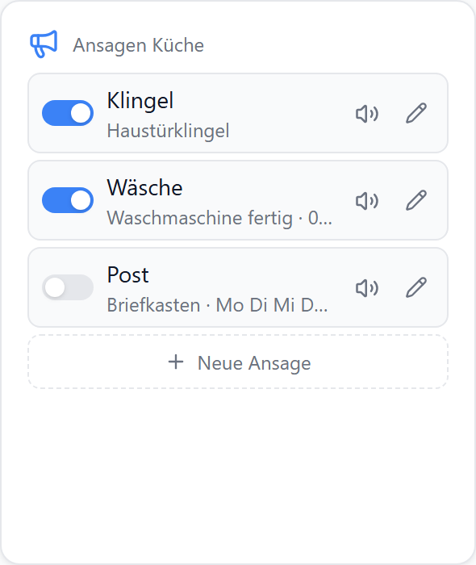
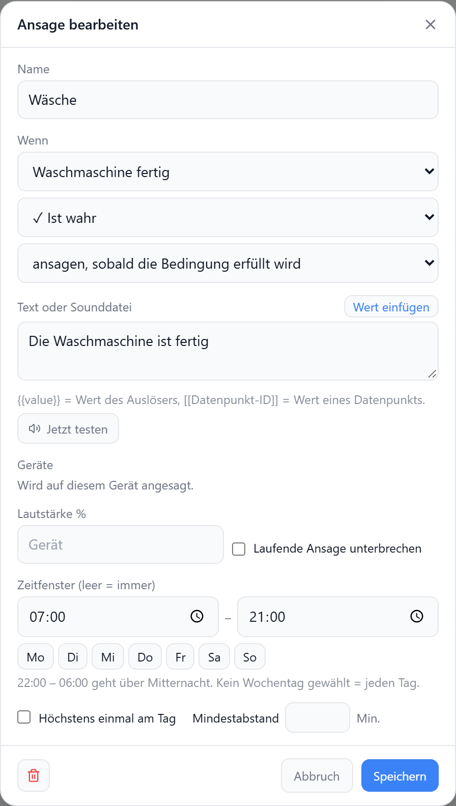
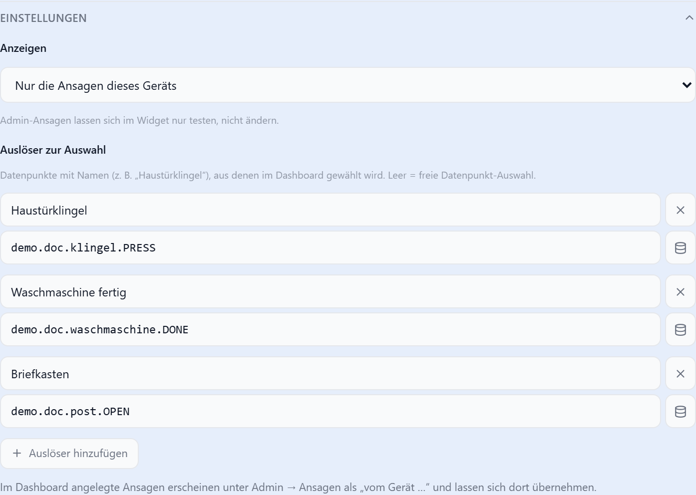

# Ansagen

Sprachansagen im Dashboard anlegen: Auslöser → Text → dieses Gerät. Es sind dieselben Regeln wie unter **Admin → Ansagen**; ausgeführt werden sie vom Adapter, auch wenn kein Dashboard offen ist. Siehe [Sprachausgabe](../anleitungen/sprachausgabe#ansagen-ohne-skript).

| Liste | Ansage bearbeiten |
| --- | --- |
|  |  |

## Wem gehört welche Ansage?

| Ansage | im Widget | unter Admin → Ansagen |
| --- | --- | --- |
| im Widget angelegt | ändern, schalten, löschen — nur auf dem Gerät, das sie angelegt hat | „vom Gerät …“; **Übernehmen** macht sie zur Admin-Ansage |
| im Admin angelegt | mit `scope: device` sichtbar, nur testen | wie bisher |

| Geräte | |
| --- | --- |
| Standard | die Ansage spricht nur auf dem Gerät, auf dem sie angelegt wurde |
| `allowOtherDevices` | Geräte frei wählbar |

## Bedienung

| Aktion | |
| --- | --- |
| Schalter | Ansage an / aus |
| 🔊 | sofort testen, ohne Bedingung und Sperre; Admin-Ansagen nur auf diesem Gerät |
| ✏️ | bearbeiten: Name, Auslöser, Bedingung, Text, Lautstärke, Zeitfenster, Sperre |
| **+ Neue Ansage** | neue Ansage für dieses Gerät |

| Feld im Popup | |
| --- | --- |
| Wenn | Auslöser (Liste aus `triggers` oder Datenpunkt) und Bedingung |
| Ansagen | sobald die Bedingung erfüllt wird oder bei jedem neuen Wert (Klingel) |
| Text oder Sounddatei | `{{value}}` = Wert des Auslösers, `[[Datenpunkt-ID]]` = Wert eines Datenpunkts |
| Zeitfenster | von–bis und Wochentage; `22:00`–`06:00` geht über Mitternacht |
| Sperre | höchstens einmal am Tag, Mindestabstand in Minuten |

Weitere Bedingungen, die der Admin einer Ansage hinzugefügt hat, bleiben beim Bearbeiten im Dashboard erhalten.

## Einstellungen

| Option | Standard | |
| --- | --- | --- |
| `scope` | `own` | `own` = Ansagen dieses Geräts, `device` = zusätzlich Admin-Ansagen, die hier sprechen |
| `allowCreate` | `true` | **+ Neue Ansage** |
| `allowEdit` | `true` | Bearbeiten und Schalter |
| `allowDelete` | `true` | Löschen im Popup |
| `allowOtherDevices` | `false` | Geräte im Popup wählbar |
| `showSummary` | `true` | zweite Zeile: Auslöser, Zeitfenster, Sperre |
| `triggers` | leer | `[{ dp, name }]` — benannte Auslöser zur Auswahl, z. B. „Haustürklingel“; leer = freie Datenpunkt-Auswahl |
| `autoHeight` | `false` | Höhe folgt der Zahl der Ansagen — siehe [Höhe an Inhalt anpassen](../einstellungen/editor#hohe-an-inhalt-anpassen) |

## Ansage am Ende eines Countdowns

Ohne Regel: direkt im [Countdown](./countdown#ansage-am-ende), z. B. „Pizza ist fertig“ auf dem Gerät, auf dem Start gedrückt wurde.
