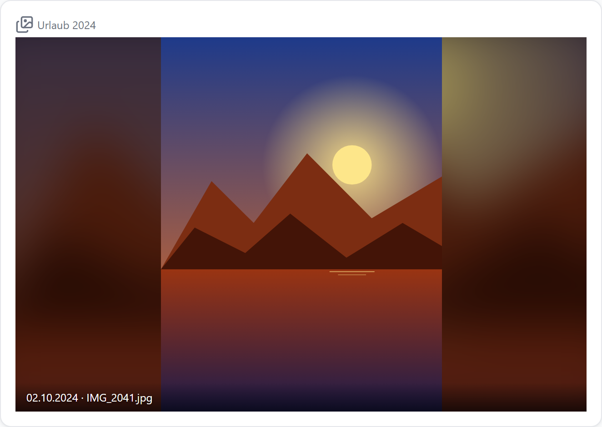
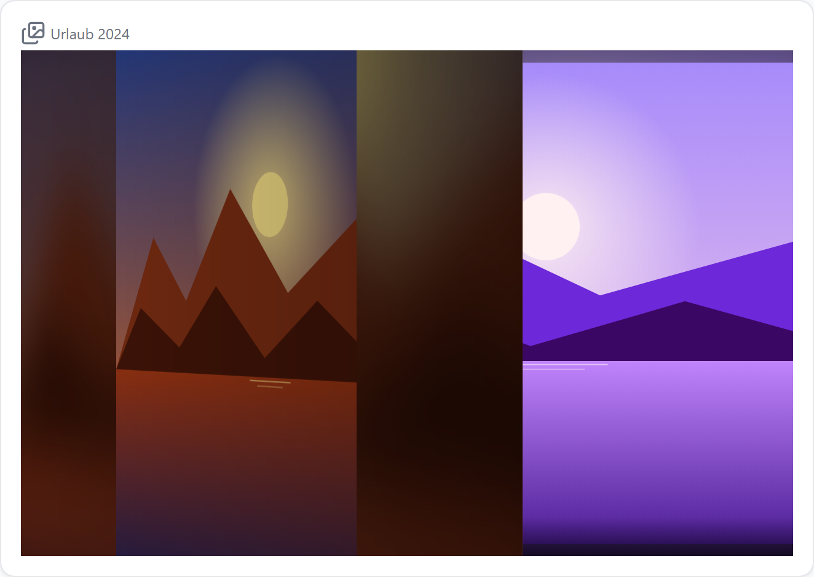
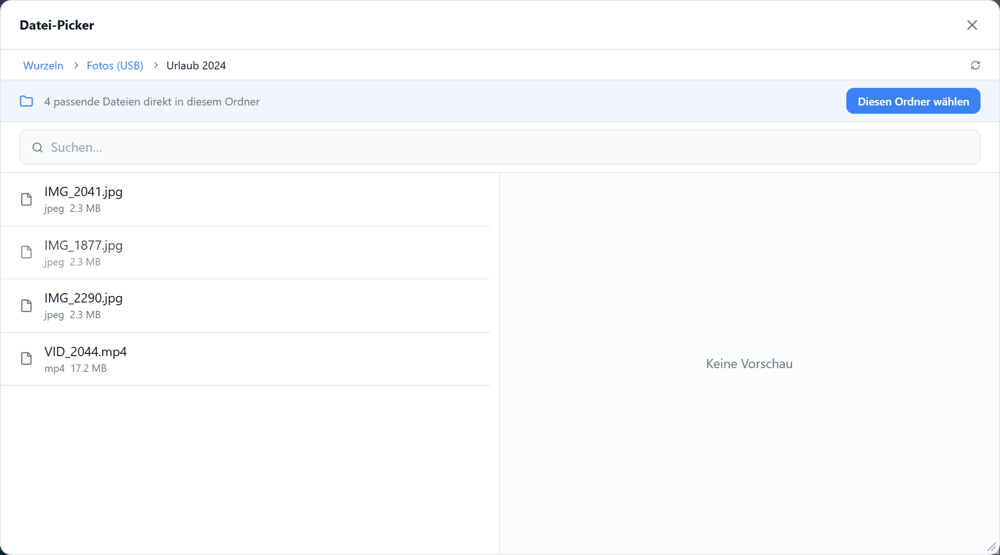
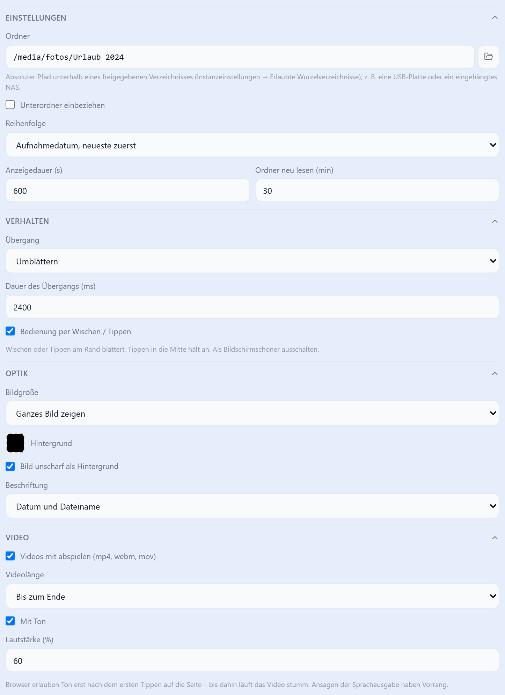

# Diashow

Zeigt Fotos und Videos aus einem Ordner nacheinander, sortiert nach Aufnahmedatum oder zufällig. Läuft als Kachel im Dashboard oder als [Bildschirmschoner](../anleitungen/bildschirmschoner).

| Kachel (Hochformat, unscharfer Hintergrund) | Bilderrahmen (`fit: cover`, ohne Titel) | Übergang „Umblättern“ |
| --- | --- | --- |
|  |  |  |

## Ordner freigeben

Die Diashow liest nur Ordner unterhalb eines freigegebenen Verzeichnisses.

**Instanzeinstellungen → Erlaubte Wurzelverzeichnisse**

| Ordner | Pfad (Beispiel) |
| --- | --- |
| ioBroker-Dateien | `/opt/iobroker/iobroker-data/files` (Standard) |
| USB-Platte am Pi | `/media/usb/fotos` |
| NAS | im Betriebssystem einhängen (SMB/NFS), dann wie ein lokaler Ordner, z. B. `/mnt/nas/fotos` |
| Windows | `C:\Users\du\Bilder` |

Der Benutzer, unter dem ioBroker läuft (meist `iobroker`), braucht Leserechte auf den Ordner.

::: warning
Ein freigegebener Ordner ist für jeden lesbar, der das Dashboard erreicht.
:::

## Ordner wählen

Im Bearbeiten-Dialog über 📂 neben **Ordner**: hineinklicken bis zum gewünschten Ordner, dann **Diesen Ordner wählen**.

## Bedienung

| Aktion | |
| --- | --- |
| Wischen nach links / rechts | nächstes / vorheriges Bild |
| Tippen am rechten / linken Rand | nächstes / vorheriges Bild |
| Tippen in die Mitte | anhalten / weiter (⏸ oben rechts) |

Mit `controls: false` reagiert die Diashow nicht auf Berührung.

## Datum und Reihenfolge

| `order` | |
| --- | --- |
| `random` (Standard) | gemischt; jede Datei einmal pro Runde, nie zweimal hintereinander |
| `dateDesc` | Aufnahmedatum, neueste zuerst |
| `dateAsc` | Aufnahmedatum, älteste zuerst |
| `name` | Dateiname (`IMG_2` vor `IMG_10`) |

| Datei | Aufnahmedatum aus |
| --- | --- |
| JPEG, WebP, PNG | EXIF (`DateTimeOriginal`) |
| MP4, MOV | Erstellzeit im Video |
| ohne diese Angabe | Dateidatum |

Der Adapter liest die Daten einmal und merkt sie sich. Bei einem großen Ordner läuft die Diashow sofort mit dem Dateidatum los; die Aufnahmedaten kommen nach und nach dazu.

## Videos

| Option | |
| --- | --- |
| `includeVideos` | mp4, m4v, webm, mov, ogv mit abspielen |
| `videoMode` | `full` = bis zum Ende, `interval` = nur die Anzeigedauer |
| `videoSound` | mit Ton |
| `videoVolume` | Lautstärke 0–100 |

| Ton | |
| --- | --- |
| vor dem ersten Tippen auf die Seite | Browser erlauben keinen Ton: Video läuft stumm, 🔇 unten rechts |
| nach dem ersten Tippen (irgendwo, auch „Ton aktivieren“ der [Sprachausgabe](../anleitungen/sprachausgabe)) | mit Ton |
| während einer Ansage der Sprachausgabe | stumm |

## Als Bildschirmschoner

Schritte wie in der Anleitung [Bildschirmschoner erstellen](../anleitungen/bildschirmschoner), mit einer Diashow als einzigem Widget der Ruhe-Ansicht.

| Option in der Ruhe-Ansicht | |
| --- | --- |
| `controls` | aus — jede Berührung beendet ohnehin den Ruhezustand |
| `fit` | `cover`, oder `contain` mit `blurBackground` |
| Titel / Icon | aus |

Die Diashow merkt sich das zuletzt gezeigte Bild und macht beim nächsten Ruhezustand mit dem folgenden weiter.

## Einstellungen

| Option | Standard | |
| --- | --- | --- |
| `folder` | – | absoluter Pfad des Ordners |
| `recursive` | `false` | Unterordner einbeziehen (bis 6 Ebenen, max. 5000 Dateien) |
| `order` | `random` | siehe oben |
| `intervalSec` | `10` | Anzeigedauer je Bild in Sekunden |
| `rescanMin` | `30` | Ordner neu lesen; neue Fotos erscheinen ohne Neuladen |
| `transition` | `fadeBlack` | `fadeBlack` Schwarzblende · `fade` Überblenden · `slide` Schieben · `pageTurn` Umblättern · `none` |
| `transitionMs` | `800` | Dauer des Übergangs |
| `controls` | `true` | Wischen / Tippen |
| `fillTab` | `false` | Tab ausfüllen: Diashow füllt den ganzen Tab (nur als einziges Widget im Tab) |
| `fit` | `contain` | `contain` = ganzes Bild · `cover` = Fläche füllen (beschnitten) |
| `background` | `#000000` | Fläche neben dem Bild, Farbe der Schwarzblende |
| `blurBackground` | `false` | bei `contain`: Bild unscharf als Hintergrund |
| `showCaption` | `none` | `name` · `date` · `nameDate` |

Versteckte Dateien und Ordner (`.…`) sowie `@eaDir`, `#recycle` und `$RECYCLE.BIN` werden übersprungen.
