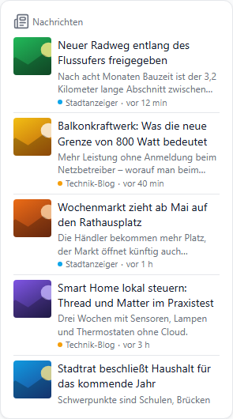
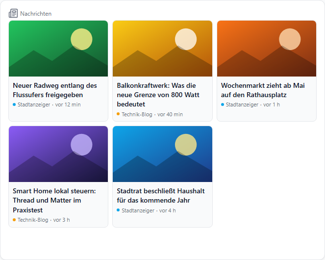
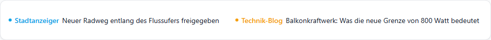
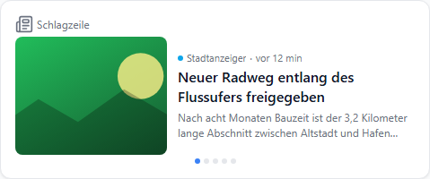
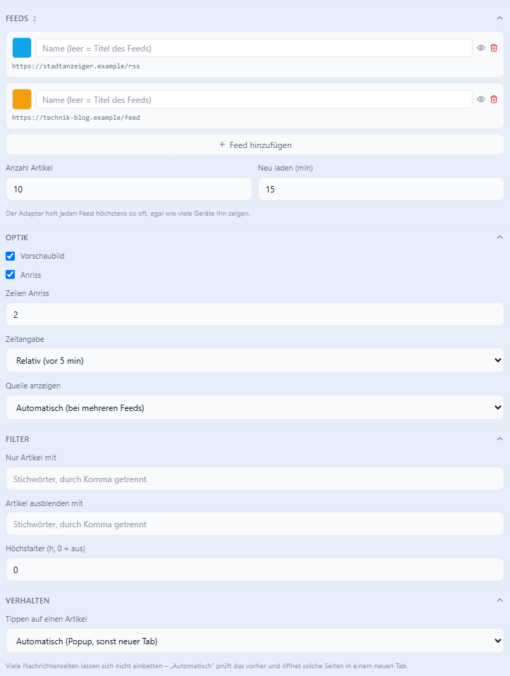

# Nachrichten (RSS)

Zeigt die Artikel von RSS- und Atom-Feeds oder vom [rssfeed-Adapter](https://github.com/oweitman/ioBroker.rssfeed). Mehrere Feeds werden nach Datum gemischt.

| Liste (`default`) | Karten (`card`) |
| --- | --- |
|  |  |

| Laufschrift (`ticker`) |
| --- |
|  |

| Einzelmeldung (`single`) |
| --- |
|  |

## Feeds

| Quelle | Eintrag |
| --- | --- |
| Adresse (URL) | Feed-Adresse, z. B. `https://www.tagesschau.de/index~rss2.xml` |
| rssfeed-Adapter | Datenpunkt des Feeds, z. B. `rssfeed.0.tagesschau` (der Dialog listet alle) |

| Adresse (URL) | |
| --- | --- |
| Abruf | über den Aura-Adapter, nicht den Browser |
| Neu laden | alle **Neu laden (min)**, für alle Geräte zusammen ein Abruf |
| Feed nicht erreichbar | letzter Stand bleibt, ⚠ in der Titelzeile |
| Zeichensatz | UTF-8 und ISO-8859-1 |

| rssfeed-Adapter | |
| --- | --- |
| Abruf | durch den Adapter, in dessen Intervall |
| Neue Artikel | sofort, sobald der Adapter den Datenpunkt schreibt |

**Name** leer = Titel des Feeds. Die Farbe markiert die Quelle an jedem Artikel. 👁 blendet einen Feed aus, ohne ihn zu löschen.

## Darstellung

| Option | |
| --- | --- |
| Vorschaubild | aus `media:thumbnail`/`media:content`, Bild-Anhang oder erstem Bild im Text |
| Anriss | Text unter dem Titel, `summaryLines` Zeilen |
| Zeitangabe | `relative` (vor 5 min) · `time` · `dateTime` · `none` |
| Quelle anzeigen | automatisch nur bei mehreren Feeds |
| Geschwindigkeit | nur Laufschrift, px/s; Maus darüber hält an |
| Wechsel nach | nur Einzelmeldung; Wischen blättert |

| Layout | Höhe |
| --- | --- |
| Liste, Karten | beliebig, scrollt |
| Laufschrift | eine Zeile (Höhe 3) |
| Einzelmeldung | ab Höhe 6 |

## Filter

| Option | |
| --- | --- |
| Nur Artikel mit | Stichwörter, durch Komma getrennt; Titel oder Anriss |
| Artikel ausblenden mit | Stichwörter, durch Komma getrennt |
| Höchstalter | ältere Artikel ausblenden; ohne Datum bleiben sie |

## Artikel öffnen

| Tippen auf einen Artikel | |
| --- | --- |
| Automatisch (Standard) | Popup, wenn die Seite das Einbetten erlaubt, sonst neuer Tab |
| Im Popup öffnen | immer Popup |
| In neuem Tab öffnen | immer neuer Tab |
| Nichts | nur anzeigen |

::: tip
Viele große Nachrichtenseiten verbieten das Einbetten. Im Popup bliebe die Fläche leer — **Automatisch** prüft das vorher.
:::
