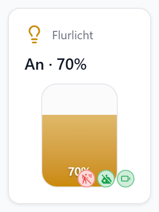
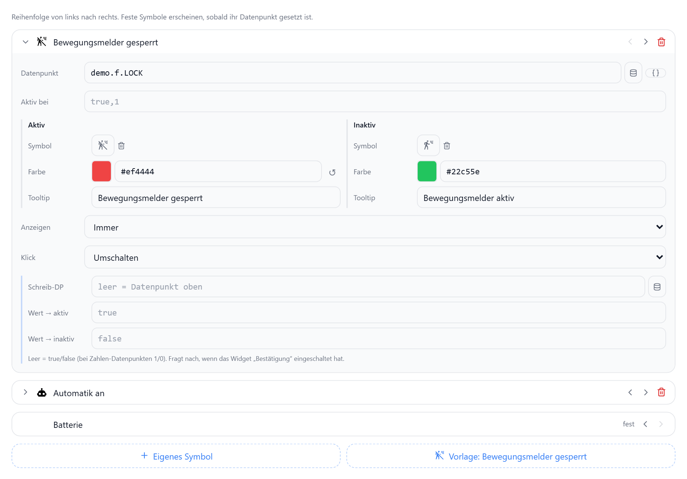

# Status-Symbole

Eigene Symbole in der Statuszeile eines Geräte-Widgets, neben Batterie, Erreichbarkeit, Fenster und Sperre. Beispiel: Bewegungsmelder gesperrt an einer Lampe, per Klick umschaltbar.

**Widget bearbeiten → Status-Datenpunkte → Eigene Symbole & Reihenfolge**

| Feld | Bedeutung | Leer = |
|---|---|---|
| Datenpunkt | Wert entscheidet aktiv / inaktiv | – |
| Aktiv bei | kommagetrennte Werte für „aktiv“ | `true,1` |
| Symbol aktiv / inaktiv | Iconify-Icon je Zustand | inaktiv = aktives Symbol |
| Farbe aktiv / inaktiv | Farbe je Zustand | Akzentfarbe / Grün |
| Tooltip | Text beim Überfahren | – |
| Anzeigen | Immer · Nur wenn aktiv · Nur wenn inaktiv | Immer („Nur bei Alarm“ = nur wenn aktiv) |
| Klick | Nur anzeigen · Umschalten | Nur anzeigen |
| Schreib-DP | Ziel beim Umschalten | Datenpunkt oben |
| Wert → aktiv / inaktiv | geschriebener Wert | `true` / `false`, bei Zahlen `1` / `0` |

| Verhalten | |
|---|---|
| Reihenfolge | Pfeile ‹ › im Dialog, gilt auch für die festen Symbole |
| Klick aufs Symbol | schaltet nur das Symbol, nicht die Kachel |
| Bestätigung | „Bestätigung“ des Widgets fragt auch hier nach |
| Editor | Klick schreibt nichts |
| Custom-Layout | Zelle **Aktion / Icon** → „Status-Badges (alle)“ oder „Eigenes Symbol: …“ einzeln |
| Vorlage | „Vorlage: Bewegungsmelder gesperrt“ legt Icons, Tooltips und Umschalten an |

Widgets: Schalter, Dimmer, RGB-Licht, Thermostat, Raumklima, Rollladen, Fensterkontakt, Binärsensor, Zustandsbild, Wert, Schieberegler, Drehknopf, Auswahl, Datumswähler, Mediaplayer.
