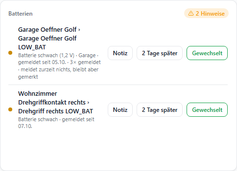
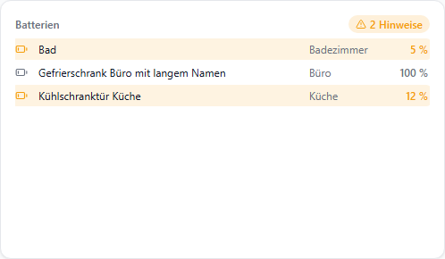
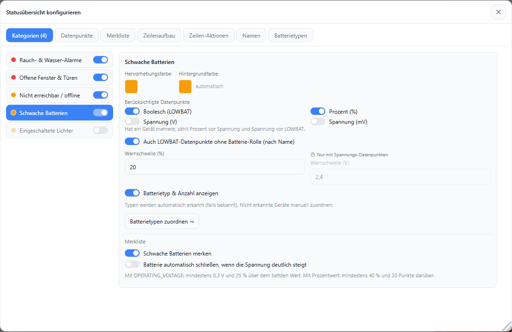
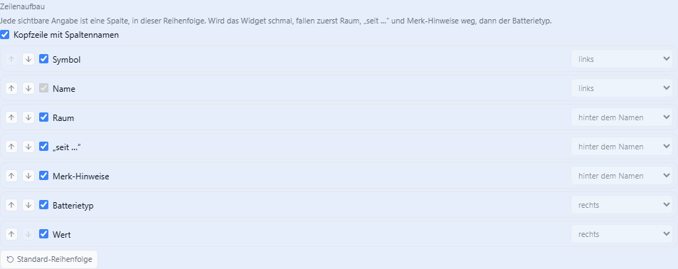
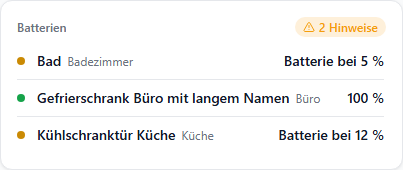
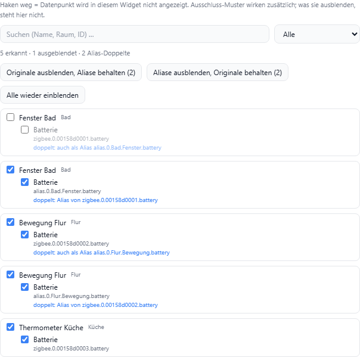
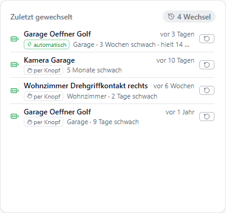

# Statusübersicht

Zeigt von selbst, was Aufmerksamkeit braucht: offene Fenster und Türen, schwache Batterien, nicht erreichbare Geräte, Rauch-/Wasseralarme, eingeschaltete Lichter. Die Geräte werden über Rollen und Gewerke gefunden, eine Liste muss niemand pflegen.

## Layouts

| Layout | |
| --- | --- |
| `default` | nach Kategorie gruppiert |
| `compact` | eine Liste, sortiert |
| `table` | Tabelle: jede Angabe eine Spalte, über alle Zeilen ausgerichtet, Kopfzeile mit Spaltennamen; Überschrift nur bei mehreren Kategorien |
| `twoline` | Zweizeilig: Punkt in der Farbe der Schwere, Name fett, darunter Messwert und Hinweise, große Knöpfe rechts; Überschrift nur bei mehreren Kategorien |
| `card` | Kacheln |
| `minimal` | Pillen |
| `count` | nur der Zähler |
| `history` | Zuletzt gewechselt – geschlossene Hinweise aus dem Adapter-Verlauf, siehe unten |

Knöpfe (Zeilen-Aktionen, „Gewechselt“, „Später“, „Verwerfen“) gibt es in `default`, `compact`, `table` und `twoline`.





## Einstellungen

Einstellungen → **Statusübersicht konfigurieren** öffnet einen Dialog mit Tabs; im Panel bleiben nur die Anzeige-Optionen.



| Ort | Inhalt |
| --- | --- |
| Panel › Optik | Textausrichtung, Kartengröße, Lange Werte umbrechen (`cardTextWrap`, Karten), Welche Geräte, Höchstzahl Zeilen, Tage (), Zahl in der Kategorie-Überschrift (`categoryCount`), Sortierung (`sortBy`) und „Danach sortieren“ (`sortThen`: Name, Raum, Dringlichkeit) |
| Panel › Einstellungen | Knopf zum Dialog mit Kurzfassung, Veröffentlichen |
| Tab Kategorien | links Kategorien an/aus, rechts deren Optionen, Farben und Merkliste der Kategorie |
| Tab Datenpunkte | Räume, Funktionen, Adapter, Ausschluss-Muster, Erkannte Datenpunkte |
| Tab Merkliste | gemeinsame Merkliste-Optionen, Ignorieren, Knopf-Farben |
| Tab Zeilenaufbau | Reihenfolge, Platz und Sichtbarkeit der Zeilenteile |
| Tab Zeilen-Aktionen | eigene Knöpfe am Zeilenende, Klick auf Zeile |
| Tab Namen | Vorschau erkannt → angezeigt; ① Aufbau (Namensmuster), ② Bereinigen (Regeln), ③ Ausnahmen (eigene Gerätenamen) |
| Tab Batterietypen | Batterietypen zuordnen (nur mit Kategorie Batterien) |

## Zahlen in der Kopfzeile

Kopfzeile → Eintrag mit Quelle **Widget-Wert** oder **Text** (alle Layouts außer `history`).

| Widget-Wert | Text-Platzhalter | |
| --- | --- | --- |
| Hinweise gesamt (`status:hints`) | `{hints}` | wie der Chip |
| Geräte gesamt (`status:devices`) | `{devices}` | überwachte Geräte, ohne ausgeblendete und „Nie mehr melden“ |
| Batterien: Hinweise / Geräte (`status:battery:hints` …) | `{battery_hints}` `{battery_devices}` | ebenso `window_`, `light_`, `unreach_`, `alarm_` |

Beispiel: `{hints} Hinweise von {devices} Geräten`. Zeigt ein Eintrag „Hinweise gesamt“ bzw. `{hints}`, entfällt der eigene Chip von selbst (nicht im Layout `count`). Haken **Als Chip** am Eintrag = Hintergrund wie beim Chip; Hinweis-Zahlen ohne eigene Farbe färben sich nach Schwere (grün, orange, rot).

| Zahl in der Kategorie-Überschrift (`categoryCount`) | |
| --- | --- |
| Hinweise | „Batterien 3“ (Standard) |
| Geräte gesamt | „Batterien 10“ |
| Hinweise / Geräte | „Batterien 3 / 10“ |

Eingeklappt zeigt die Kopfzeile die zuletzt gezählten Werte – erst nach dem ersten Aufklappen.

## Zeilenaufbau

Tab **Zeilenaufbau** (`rowParts`) – Layouts `default`, `compact`, `table`, `twoline`



| Element | |
| --- | --- |
| Pfeile | Reihenfolge |
| Haken | anzeigen; Raum, „seit …“, Batterietyp schalten `showRoom`, `showSince`, `batteryTypeEnabled` |
| links / hinter dem Namen / rechts | Platz in der Zeile; „links“ hinter dem Namen = direkt neben dem Namen, „hinter dem Namen“ = gedämpft an den Namen gehängt |
| Standard-Reihenfolge | zurück auf die eingebaute Zeile |

| Layout `table` | |
| --- | --- |
| Spalten | jede sichtbare Angabe, in der Reihenfolge der Liste; die Seite zählt nicht |
| Wert | rechtsbündig |
| Kopfzeile | Spaltennamen (Gerät, Raum, Seit, Hinweis, Typ, Wert); Haken „Kopfzeile mit Spaltennamen“ (`tableHeader`) |
| leere Spalte | entfällt, wenn keine Zeile etwas dafür hat |
| schmales Widget | unter ca. 350 px fallen Raum, „seit …“, Merk-Hinweise weg, unter ca. 240 px auch der Batterietyp |

| Layout `twoline` | |
| --- | --- |
| Zeile 1 | hinter dem fetten Namen |
| Zeile 2 | darunter; Vorgabe: Messwert, Batterietyp, Raum, „seit …“, Merk-Hinweise |
| rechts | vor den Knöpfen |
| Symbol | der farbige Punkt |



## Batterien erkennen

| Quelle | zählt als Batterie |
| --- | --- |
| Rolle `value.battery` (Zahl) | immer, Prozent gegen `batteryThreshold` |
| `LOWBAT`/`LOW_BAT` (Rolle `indicator.lowbat` oder Name) | außer HomeMatic immer |
| HomeMatic-`LOWBAT` | nur wenn das Gerät `OPERATING_VOLTAGE` hat **oder** sein Modell in der Batterie-Bibliothek steht (klassische Geräte wie HM-Sec-SCo, HM-Sec-RHS, HM-Sec-SD-2) **oder** ihm ein Batterietyp zugewiesen ist |
| HomeMatic, Modell unbekannt, ohne Spannung | nein – Netz-Aktoren tragen ebenfalls ein `LOWBAT` |
| Treffer in `batteryExtraPatterns` | immer, egal welche Rolle – Zahl oder Text = Prozent, boolesch = LOWBAT |

`LOWBAT` in Kanal 0 und 1 desselben Geräts ergibt eine Zeile (Kanal 0).

### Welche Datenpunkte zählen (`batteryKinds`)

| Art | Vorgabe | erkannt an | schwach bei |
| --- | --- | --- | --- |
| `bool` – Boolesch (LOWBAT) | an | Rolle `indicator.lowbat` oder Name | `true` |
| `percent` – Prozent (%) | an | Rolle `value.battery` | ≤ `batteryThreshold` (20 %) |
| `volt` – Spannung (V) | aus | Einheit `V` und `OPERATING_VOLTAGE` oder „batt“ in Id, Rolle, Name | ≤ `batteryVoltThreshold` (2,4 V) |
| `millivolt` – Spannung (mV) | aus | dasselbe mit Einheit `mV` | ≤ `batteryVoltThreshold` × 1000 |

- Ein Gerät, eine Zeile: Prozent vor Spannung, Spannung vor LOWBAT.
- Geräte mit nur einer 1,5-V-Zelle (1× AA/AAA laut Batterietyp oder manueller Zuordnung, z. B. HmIP-SWDO) nutzen „Schwelle 1× 1,5 V“ (`batteryVoltThreshold1Cell`, 1,2 V).
- Netzspannung (`Voltage` einer Steckdose) zählt nicht. 0 V (netzbetriebene HmIP-Geräte mit `OPERATING_VOLTAGE`) ergibt keine Zeile und keinen gemerkten Hinweis.
- Mit Optik → „Welche Geräte anzeigen: Alle gefundenen Geräte“ (`valueFilter: all`) stehen die Spannungen auch ohne Warnung in der Liste („2,95 V“).

| Fall | Abhilfe |
| --- | --- |
| Rauch-/Wassermelder ohne Alarm-Rolle, z. B. Shelly Flood über MQTT (`….sensor.flood`, Rolle `state`) | Kategorie Rauch- & Wasser-Alarme → „Zusätzliche Alarm-Datenpunkte“ (`alarmExtraPatterns`, Text oder `/regex/`, z. B. `/\.sensor\.flood$/`); ausgelöst bei `true` bzw. `1` |
| Fenster-/Türkontakt ohne Fenster-Rolle | Kategorie Offene Fenster & Türen → „Zusätzliche Fenster- und Tür-Datenpunkte“ (`windowExtraPatterns`); `true`/`1`/„open“ = offen, `2`/„tilted“ = gekippt |
| Lampe ohne Licht-Rolle, z. B. Steckdose mit Stehlampe oder Licht über MQTT | Kategorie Eingeschaltete Lichter → „Zusätzliche Licht-Datenpunkte“ (`lightExtraPatterns`); boolesch = an/aus, Zahl = Helligkeit |
| Gerät ohne Batterie-Rolle, z. B. Shelly über MQTT (`mqtt.0.shelly.…`, Rolle `variable`) | Kategorie Batterien → „Zusätzliche Batterie-Datenpunkte“ (`batteryExtraPatterns`, Text oder `/regex/`, z. B. `/^mqtt.0.shelly..*.battery$/`); eng fassen, sonst zählt ein Hausspeicher mit |
| Tote Doubletten: dieselben HmIP-Seriennummern (`000…`) zusätzlich unter einer alten `hm-rpc`-Instanz, Werte eingefroren | `excludeIdPatterns` (Teilstring oder `/regex/`, z. B. `/^hm-rpc.2.000/`) – sonst werden sie mitüberwacht |

Neben jedem Feld „Zusätzliche … Datenpunkte“ hängt **+ Datenpunkt** einzelne Datenpunkte aus der Auswahl an (Mehrfachauswahl, ein Ordner-Haken nimmt alle darunter). Eine ID wirkt wie jedes Text-Muster als Teilstring.

## Fenster & Türen erkennen

| Quelle | zählt als Fenster/Tür |
| --- | --- |
| Rolle `sensor.window`, `sensor.door`, `window`, `door` | immer |
| Rolle `value.window`, `value.door` (hm-rega, z. B. HM-Sec-SCo 0/1) | immer |
| Zustände geschlossen / gekippt / offen (Drehgriff) | immer |
| `WINDOW_STATE` (Thermostat, Heizgruppe) oder HomeMatic-Gruppe (`INT…`) | nur in Räumen ohne eigenen Fensterkontakt |

## Einzelne Datenpunkte ausblenden

Tab Datenpunkte → **Erkannte Datenpunkte**



| Element | |
| --- | --- |
| Haken | an = angezeigt, aus = Id landet in `excludeIds` |
| Haken am Gerät | alle Datenpunkte des Geräts |
| Marke „Alias“ / „Original“ | Alias und Original werden beide gefunden; Ziel im Tooltip |
| „Weitere … anzeigen“ | ab 100 Geräten; Suche und Filter gelten für alle |
| Originale / Aliase ausblenden | blendet von jedem Alias-Paar eine Seite aus |
| Nicht mehr gefunden | ausgeblendete Ids ohne Treffer; Haken setzen = entfernen |
| `excludeIdPatterns` | wirkt zusätzlich, ausgeblendete Treffer stehen nicht in der Liste |

## Namen

| Option | |
| --- | --- |
| `deviceNames` | eigener Name je Gerät (Tab Namen); gilt für alle Zeilen des Geräts |
| `namePattern` / `nameFilters` | laufen danach; Vorlage „HomeMatic-Kanal (:1) weg“ |

| Erkannter Name | Regel |
| --- | --- |
| Kanal „Channel sensor“, „Kanal 1“ | übersprungen, Gerätename statt dessen |
| `X:0.LOW_BAT` unter Kanal `X:0` | wird zu `X:0 › LOW_BAT` |

## Merkliste

Batteriegeräte (vor allem HomeMatic) setzen LOWBAT bei Kälte oder Last kurz auf `true` und danach wieder auf `false`. Mit der **Merkliste** (je Kategorie im Tab Kategorien, gemeinsame Optionen im Tab Merkliste) bleibt ein solcher Hinweis stehen, bis er geschlossen wird – für Batterien, nicht erreichbare Geräte und ausgelöste Rauch-/Wassermelder.

| Option | Vorgabe | |
| --- | --- | --- |
| `latchBattery` | aus | schwache Batterien merken |
| `latchUnreach` | aus | Ausfälle merken |
| `latchAlarm` | aus | ausgelöste Rauch-/Wassermelder merken |
| `latchSnoozeDays` | 2 | „Später“ stellt um so viele Tage zurück |
| `latchRecheckDays` | 7 | Nachkontrolle nach dem Schließen |
| `latchAutoClose` | aus | Batterie: schließt bei deutlichem Spannungs-/Prozentsprung |
| `latchConfirm` | an | „Gewechselt“/„Quittieren“ erst nach zweitem Tippen |
| `latchIgnore` | aus | Knopf „Ignorieren“ (mit Rückfrage) – für Fehlalarme, wirkt auch ohne Merkliste |
| `latchActionColors` | – | Farbe je Knopf `{ ack, snooze, dismiss, ignore }` (Text + Rahmen), CSS-Farbe oder Token |
| `showIgnored` | aus | ignorierte Datenpunkte gedämpft zeigen, mit „Aufnehmen“ |

| Anzeige in der Zeile | Bedeutung |
| --- | --- |
| seit 05.10. | erste Meldung |
| 3× gemeldet | so oft von „ok“ auf „Problem“ gewechselt |
| meldet zurzeit nichts, bleibt gemerkt | Datenpunkt ist wieder ok – Zeile gedämpft; statt „Später“ gibt es „Verwerfen“ |
| 1,6 V · tiefster Wert 1,1 V | ruhige Batterie: aktueller Wert, dazu der tiefste seit der Meldung (Zweizeilig: „Batterie war schwach (1,1 V), jetzt 1,6 V“) |
| zurückgestellt bis 07.10. | „Später“ getippt – gedämpft, zählt nicht im Zähler |
| trotz Wechsel am 01.10. | in der Nachkontrolle erneut gemeldet |

| Regel | |
| --- | --- |
| Nachkontrolle | Nur eine Meldung mindestens 10 min nach dem Schließen öffnet wieder – ein alter, stehengebliebener Wert nicht. |
| Automatisch schließen (Spannung) | `OPERATING_VOLTAGE` mindestens 0,3 V **und** 25 % über dem tiefsten Wert des Eintrags |
| Automatisch schließen (Prozent) | mindestens 40 % **und** 30 Punkte über dem tiefsten Wert |
| Automatisch schließen (nur `LOWBAT`) | nie – klassische HomeMatic-Geräte ohne Spannung schließt „Gewechselt“; `LOWBAT` flattert bei Kälte |

| Verwerfen | |
| --- | --- |
| Wofür | veraltete oder falsche Hinweise, z. B. nach einer zu hoch eingestellten Warnschwelle |
| Wann | nur bei Einträgen, die zurzeit nichts melden; mit Rückfrage wie „Gewechselt“ (`latchConfirm`) |
| Wirkung | Eintrag weg, kein Verlaufseintrag, keine Nachkontrolle; der Datenpunkt bleibt überwacht – meldet er wieder, ist der Hinweis neu da |
| Unterschied zu „Ignorieren“ | „Ignorieren“ schließt den Datenpunkt dauerhaft aus |

Die Liste führt der Adapter: alle Browser sehen dieselbe, „Gewechselt“ schließt überall gleichzeitig, und gemerkt wird auch ohne offenen Browser.

| Ignorieren | |
| --- | --- |
| Wofür | Meldungen, die nie von selbst verschwinden – z. B. eine leere Wallbox, deren `vehicleSoc` dauerhaft 0 % meldet |
| Wirkung | wird nie mehr gemerkt, kein Event mehr, in keiner Statusübersicht sichtbar |
| Beim Ignorieren | vorhandener Eintrag verschwindet sofort; Event `closed` mit `reason: "ignored"`; kein Verlaufseintrag |
| Zurücknehmen | „Aufnehmen“ (mit `showIgnored`) oder `unignore:<id>` – der aktuelle Wert zählt sofort wieder |

`excludeIdPatterns`, `excludeIds` und `filterAdapters` wertet der Adapter aus der gespeicherten Konfiguration selbst aus – eine Änderung wirkt sofort, auch ohne offenen Browser.

### Adapter-States

| State | Richtung | Inhalt |
| --- | --- | --- |
| `aura.0.status.<cat>.list` | Adapter → alle | JSON-Liste der Einträge |
| `aura.0.status.<cat>.cmd` | Widget / Skript → Adapter | Befehle, siehe unten |
| `aura.0.status.<cat>.event` | Adapter → Skript | `new` · `reopened` · `closed` (JSON) |
| `aura.0.status.<cat>.history` | Adapter → alle | geschlossene Einträge, neueste zuerst (JSON) |
| `aura.0.status.<cat>.ignored` | Adapter → alle | ignorierte Datenpunkte `{id, name, ignoredAt}` (JSON) |
| `aura.0.status.<cat>.cmdResult` | Adapter → Skript | Ergebnis des letzten Befehls `{ts, cmd, ok, done, errors, notes}` |
| `aura.0.status.<cat>.sources` | Adapter | welche Widgets was beobachten |
| `aura.0.status.register` | Widget → Adapter | Anmeldung der Widgets |

`<cat>` = `battery`, `unreach` oder `alarm`.

| Feld eines Eintrags | |
| --- | --- |
| `id`, `name`, `room` | Datenpunkt, Gerätename, Raum |
| `since`, `last` | erste / letzte Meldung (ms) |
| `count` | wie oft gemeldet |
| `active` | meldet gerade |
| `snoozedUntil` | zurückgestellt bis (ms) |
| `ackedAt`, `closedBy` | geschlossen am, durch `ack` / `auto` |
| `reopenedAfter` | wieder geöffnet nach Schließen am (ms) |
| `minLevel`, `level`, `unit` | tiefster / aktueller Spannungs- bzw. Prozentwert (nur offene Einträge mit Wert) |

| Befehl | |
| --- | --- |
| `ack:<id>` | schließen („Gewechselt“) |
| `snooze:<id>` / `snooze:<id>@3` | zurückstellen (Vorgabe 2 Tage) |
| `unsnooze:<id>` | Zurückstellen aufheben |
| `add:<id>` / `add:<id>@2026-09-20` | Eintrag anlegen, optional mit „seit“ |
| `remove:<id>` | Eintrag löschen („Verwerfen“), ohne Nachkontrolle und ohne Verlaufseintrag |
| `reopen:<id>@<closedAt>` | Wechsel zurücknehmen: Verlaufseintrag weg, Eintrag wieder offen, Event `reopened` mit `reason: "manual"` |
| `ignore:<id>` | nie mehr merken, Eintrag sofort weg |
| `unignore:<id>` | Ignorieren aufheben |
| `import:<JSON-Array>` | alten Verlauf übernehmen: `{datenpunkt, ts, seit, name, art}` oder das eigene Format; Doppelte werden übersprungen |
| `{"cmd":"add","id":"…","since":…,"count":3}` | JSON, auch als Array |

`<id>` ist der Datenpunkt, die Geräte-Id oder nur die Seriennummer (`ack:0020da499b8f41`). Mehrere Ids kommagetrennt: `remove:<id1>,<id2>`.

Befehle laufen nacheinander. Jeder wird mit `ack=true` bestätigt; vorher steht sein Ergebnis in `cmdResult` (`ok: false` + `errors` bei unbekannter Id oder Tippfehler).

```js
// Benachrichtigung bei neuem oder wieder geöffnetem Eintrag
on({ id: 'aura.0.status.battery.event', change: 'any' }, (obj) => {
    const e = JSON.parse(obj.state.val);
    if (e.type === 'new') sendTo('telegram.0', `Batterie schwach: ${e.name}`);
    if (e.type === 'reopened') sendTo('telegram.0', `Batterie wieder schwach: ${e.name}`);
    // closed: reason ack / auto = gewechselt; remove / ignored = keine Wechsel-Meldung
    if (e.type === 'closed' && (e.reason === 'ack' || e.reason === 'auto'))
        sendTo('telegram.0', `Batterie gewechselt: ${e.name}`);
});

// Bestehenden Verlauf übernehmen (0_userdata.0.Batterien.Verlauf holt der Adapter
// beim Start selbst, solange sein eigener Verlauf leer ist)
setState('aura.0.status.battery.cmd', `import:${getState('0_userdata.0.Batterien.Verlauf').val}`);

// Bestehende Merkliste übernehmen (Schlüssel = Seriennummer)
const alt = JSON.parse(getState('0_userdata.0.Batterien.Merkliste').val || '{}');
setState('aura.0.status.battery.cmd', JSON.stringify(
    Object.entries(alt).map(([serial, v]) => ({ cmd: 'add', id: serial, since: v.since })),
));
```

## Inhalt veröffentlichen

Die angezeigten Hinweise als Datenpunkte, z. B. für einen Tagesbericht. Der Adapter wertet die Werte selbst aus, auch ohne geöffneten Browser. Welche Datenpunkte dazugehören, meldet das Widget beim ersten Öffnen nach dem Speichern.

| Option | Standard | |
| --- | --- | --- |
| `publishCount` | `false` | Hinweise nach `aura.0.lists.<id>.*` schreiben |

| Datenpunkt | Inhalt |
| --- | --- |
| `aura.0.lists.<id>.count` | Anzahl der Zeilen |
| `aura.0.lists.<id>.items` | Zeilen als JSON-Array |
| `aura.0.lists.<id>.text` | Zeilen als Text „Raum: Name (Wert)“, eine pro Zeile |
| `aura.0.lists.<id>.ts` | letzte inhaltliche Änderung (ms) |

| Feld in `items` | |
| --- | --- |
| `id`, `name`, `room` | Datenpunkt, angezeigter Name, Raum |
| `category` | `window` · `battery` · `unreach` · `alarm` · `light` |
| `severity`, `text` | `crit` · `warn` · `ok`, Statustext („Geöffnet“, „12 %“) |
| `val`, `lc` | Rohwert, letzte Änderung (ms) |
| `latched`, `since` | gemerkter Hinweis, gemeldet seit (ms) |

```js
// javascript-Adapter: jeden Abend um 22 Uhr
schedule('0 22 * * *', () => {
    const n = getState('aura.0.lists.<id>.count').val;
    if (!n) return;
    const text = getState('aura.0.lists.<id>.text').val;
    sendTo('email.0', { subject: `${n} Hinweise`, text });
    sendTo('telegram.0', { text: `${n} Hinweise\n${text}` });
});
```

## Zuletzt gewechselt

Layout `history`: eine zweite Statusübersicht neben der Merkliste, die zeigt, was geschlossen wurde. Die Daten führt der Adapter (`aura.0.status.<cat>.history`), sie überstehen einen Neustart und sind auf allen Geräten gleich.



| Zeile | |
| --- | --- |
| Name | wie in den anderen Layouts (`namePattern`, `nameFilters`) |
| vor 3 Tagen | Zeitpunkt des Wechsels – genau im Tooltip |
| per Knopf / automatisch | „Gewechselt“ getippt bzw. Spannungs-/Prozentsprung erkannt |
| 3 Wochen schwach | Zeit von der ersten Meldung bis zum Wechsel |
| hielt 14 Monate | Zeit seit dem vorigen Wechsel desselben Geräts – nur ab dem zweiten |
| 1,1 V → 1,5 V | Spannung/Prozent vor und nach dem Wechsel, wenn bekannt |
| ↺ | „Wieder öffnen“ – nach zweitem Tippen zurück in die Merkliste |

| Option | Vorgabe | |
| --- | --- | --- |
| `maxRows` | – | höchstens so viele Zeilen, Rest als „+N weitere“; macht die Höhe planbar |
| `maxAgeDays` | – | nur Wechsel der letzten N Tage |
| `showReason` | an | per Knopf / automatisch |
| `showDuration` | an | wie lange schwach |
| `showLifetime` | an | wie lange die Batterie davor hielt |
| `showRoom` | an | Raum |
| `catBattery`, `catUnreach`, `catAlarm` | an | welche Verläufe |
| `excludeIds`, `excludeIdPatterns`, `filterRooms`, `filterFuncs`, `filterAdapters` | – | wie in den anderen Layouts |

Die Merkliste-Optionen (`latch…`), Zeilen-Aktionen und die Bewertung der Live-Werte wirken in diesem Layout nicht. Die Verlaufs-Instanz meldet nichts beim Adapter an – das tut die Live-Instanz.

| Adapter-Einstellung (Instanz) | Vorgabe | |
| --- | --- | --- |
| Gespeicherte Wechsel | 50 | je Kategorie |
| Wechsel aufbewahren (Tage) | 730 | 0 = unbegrenzt |

Der jeweils letzte Wechsel eines Geräts bleibt immer erhalten, damit der nächste „hielt …“ zeigen kann.

| Feld eines Verlaufseintrags | |
| --- | --- |
| `id`, `name`, `room` | Datenpunkt, Gerätename, Raum |
| `since` | schwach seit (ms) |
| `closedAt` | gewechselt am (ms) |
| `reason` | `ack` (Knopf) · `auto` (Sprung erkannt) |
| `levelBefore`, `levelAfter`, `unit` | Spannung/Prozent vor und nach |
| `count` | wie oft gemeldet |
| `prevClosedAt` | voriger Wechsel desselben Geräts (ms) |
| `imported` | aus einem alten Verlauf übernommen |

**Liste und Verlauf:** Ein geschlossener Eintrag bleibt für die Nachkontrolle (`latchRecheckDays`) mit `ackedAt`/`closedBy` in `list` – nur dort kann eine neue Meldung ihn wieder öffnen („trotz Wechsel am …“). Der Wechsel selbst steht ab dem Schließen in `history` und bleibt dort, wenn der Listeneintrag nach der Nachkontrolle verschwindet.

## Zeilen-Aktionen

Eigene Knöpfe am Zeilenende, die einen Wert in einen Datenpunkt schreiben (`rowActions`).

| Feld | |
| --- | --- |
| `label` | Beschriftung |
| `targetDp` | Ziel-Datenpunkt |
| `value` | Wert, Platzhalter erlaubt |
| `categories` | nur bei diesen Kategorien (leer = alle): `alarm` · `window` · `unreach` · `battery` · `light` |
| `confirm`, `confirmLabel` | erst nach zweitem Tippen (Text des scharfen Knopfs, Vorgabe „Wirklich?“) |

| `value` | wird geschrieben als |
| --- | --- |
| `true` / `false` | Boolean |
| `42`, `-1`, `3.5` | Zahl |
| alles andere | Text (nach Einsetzen der Platzhalter) |

Ein Knopf erscheint, wenn alles drei zutrifft:

| Bedingung | |
| --- | --- |
| Zeile wird gezeigt | Standard: nur Auffälliges (Licht an, Fenster offen …); mit „Alle gefundenen Geräte“ an jeder Zeile |
| Kategorie passt | `categories` leer = jede Zeile |
| Layout | `default`, `compact`, `table` oder `twoline` |

| Vorlage | Knopf | Ziel / Wert | Kategorie |
| --- | --- | --- | --- |
| Licht aus | Aus | `{id}` / `false` – der Datenpunkt der Zeile selbst | Lichter |
| Fenster: Erinnern | Erinnern | eigener Datenpunkt / `{name} ({room}) ist offen` | Fenster & Türen |
| Batterie: an Skript melden | Gewechselt | eigener Datenpunkt / `gewechselt:{serial}`, mit Rückfrage | Batterien |

| Platzhalter | Beispiel |
| --- | --- |
| `{id}` | `hm-rpc.1.0020DA499B8F41.0.LOW_BAT` |
| `{device}` | `hm-rpc.1.0020DA499B8F41` |
| `{serial}` | `0020DA499B8F41` |
| `{name}` | angezeigter Name |
| `{room}` | Raum |

## „seit …“

`sinceCategories` (Vorgabe `["window"]`) schaltet die Dauer auch für `battery` und `unreach` ein.
