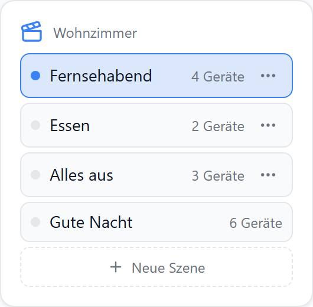
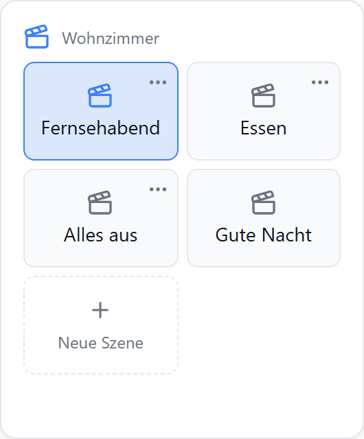
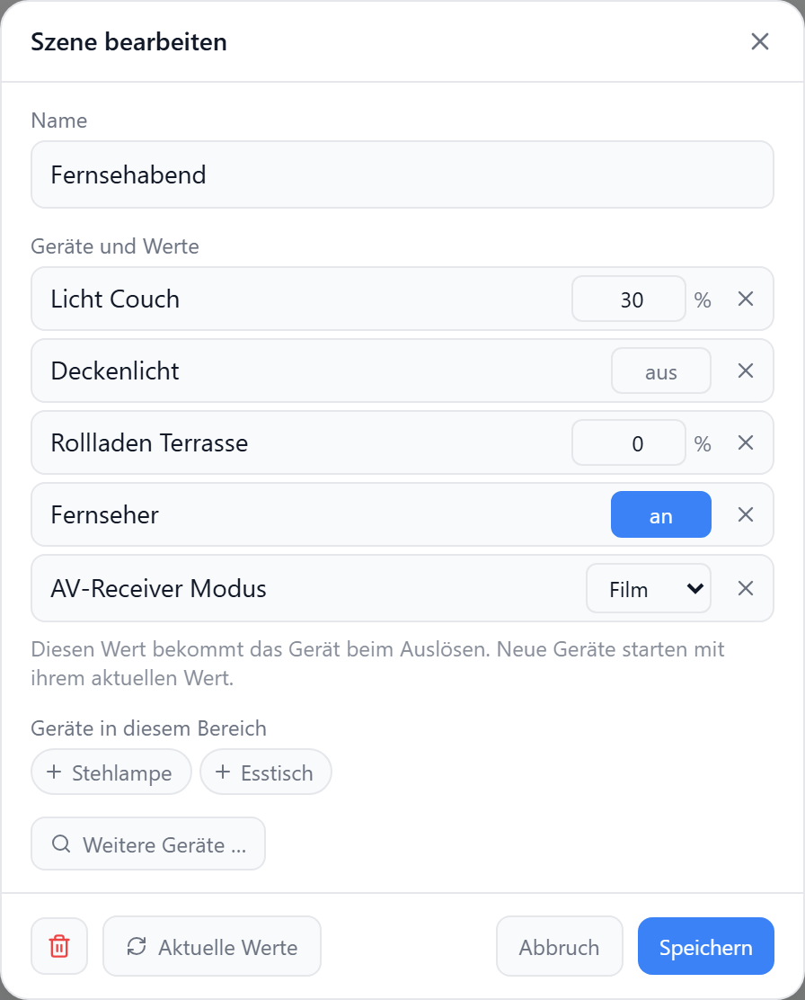
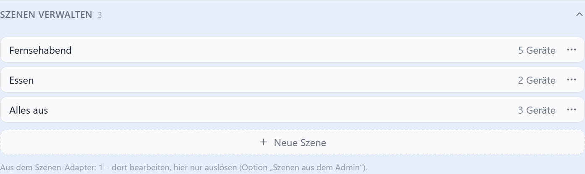
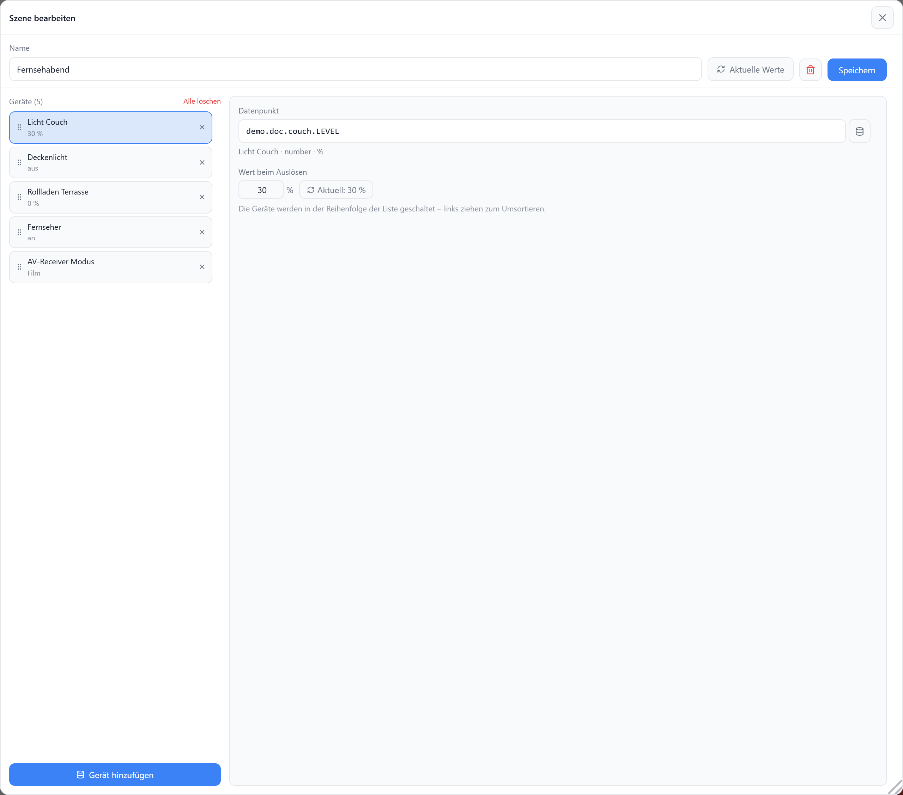

# Szenen

Löst Szenen des ioBroker-Szenen-Adapters (`scenes`) aus. Neue Szenen legst du direkt in Aura an: Geräte wählen, Werte festlegen, fertig. Aura speichert keine eigenen Szenen. Alle liegen als `scene.0.*` im Szenen-Adapter und funktionieren auch in Skripten, Blockly und Alexa.

| Liste | Kacheln | Bearbeiten im Dashboard (`allowEdit`) |
| --- | --- | --- |
|  |  |  |

## Voraussetzung

| | |
| --- | --- |
| Adapter | `scenes` installiert und gestartet; die Instanz findet Aura selbst |

## Szenen verwalten

Im Bearbeiten-Dialog des Widgets, Abschnitt **Szenen verwalten**; **+ Neue Szene** bzw. **⋯** öffnet den Editor. Mit der Option `allowEdit` geht das in vereinfachter Form auch direkt im Dashboard (Bild oben rechts).

| Szenen verwalten | Szene bearbeiten |
| --- | --- |
|  |  |

| Im Editor | |
| --- | --- |
| Liste links | Geräte der Szene; ziehen = Reihenfolge, in der sie geschaltet werden |
| **Gerät hinzufügen** | Datenpunkt-Suche, mehrere auf einmal |
| **Datenpunkt** | Datenpunkt des Geräts ändern (Eingabe oder Suche) |
| **Wert beim Auslösen** | an/aus, Zahl, Auswahlliste (bei `common.states`) oder Text; **Aktuell: …** übernimmt den momentanen Wert |
| neues Gerät | startet mit seinem aktuellen Wert |
| **Aktuelle Werte** | alle Werte auf den momentanen Zustand der Geräte setzen |
| **🗑** | Szene löschen (mit Rückfrage) |
| **Speichern** | schreibt die Szene in den Szenen-Adapter |

Erlaubt ist jeder beschreibbare Datenpunkt außer `system.*` und `scene.*`.

| Szenen | bearbeitbar | Ablage |
| --- | --- | --- |
| in Aura angelegt | ja | `scene.0.aura.<name>` |
| im Admin des Szenen-Adapters angelegt | nein, nur auslösen | `scene.0.…` |

## Bedienung

| Aktion | |
| --- | --- |
| Tipp auf eine Szene | Szene auslösen |
| hervorgehoben | alle Geräte stehen auf den Werten der Szene |

Wer im Dashboard Szenen ändern darf, regelt `allowEdit` zusammen mit dem PIN von Bereich oder Tab.

## Einstellungen

| Option | Standard | |
| --- | --- | --- |
| `layout` | `default` | `default` = Liste, `card` = Kacheln |
| `allowEdit` | `false` | Szenen auch im Dashboard anlegen und bearbeiten |
| `showDeviceCount` | `true` | Anzahl Geräte je Szene (Liste) |
| `showForeignScenes` | `false` | Szenen aus dem Admin mit anzeigen |
| `autoHeight` | `false` | Höhe folgt der Zahl der Szenen — siehe [Höhe an Inhalt anpassen](../einstellungen/editor#hohe-an-inhalt-anpassen) |

## Hinweise im Widget

| Hinweis | Ursache |
| --- | --- |
| Szenen-Adapter nicht installiert | Adapter `scenes` fehlt |
| Szenen-Adapter läuft nicht | Instanz gestoppt, Auslösen wirkt nicht |
| keine weiteren Szenen (unter „Szenen verwalten“) | im Admin des Szenen-Adapters ist nichts angelegt; `showForeignScenes` zeigt dann nichts |
| Ohne Wert (beim Auslösen „aus“) | Gerät hatte beim Speichern keinen Wert |
| Nicht als Szenen-Gerät nutzbar | Datenpunkt nur lesbar, `system.*` oder `scene.*` |
| nicht verfügbar (im Popup) | Datenpunkt existiert nicht mehr; Gerät entfernen |
