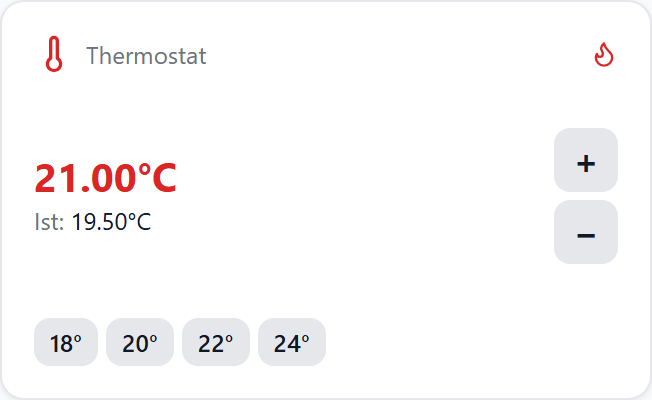
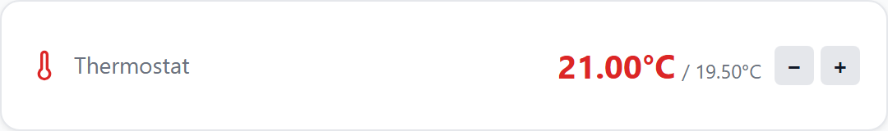
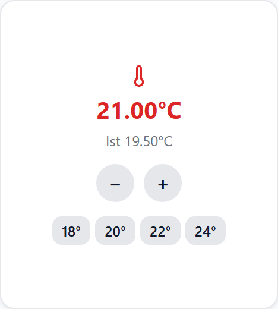
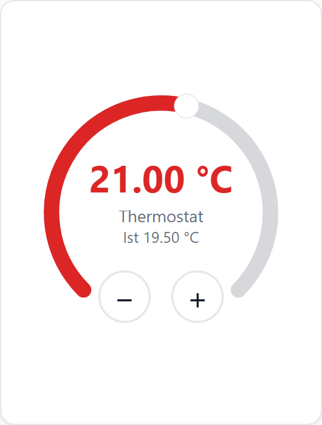
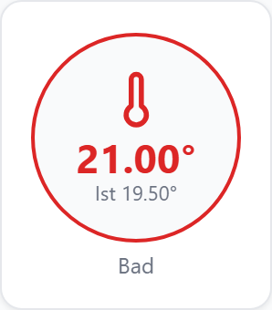
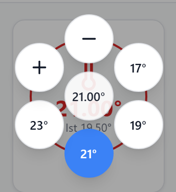
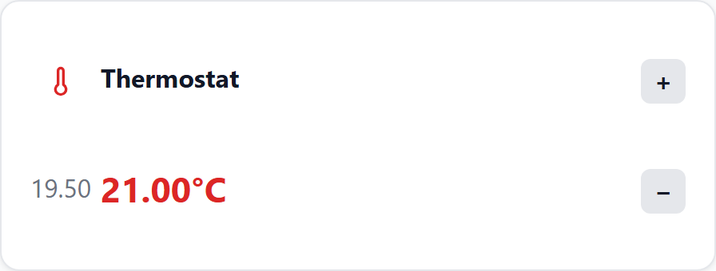
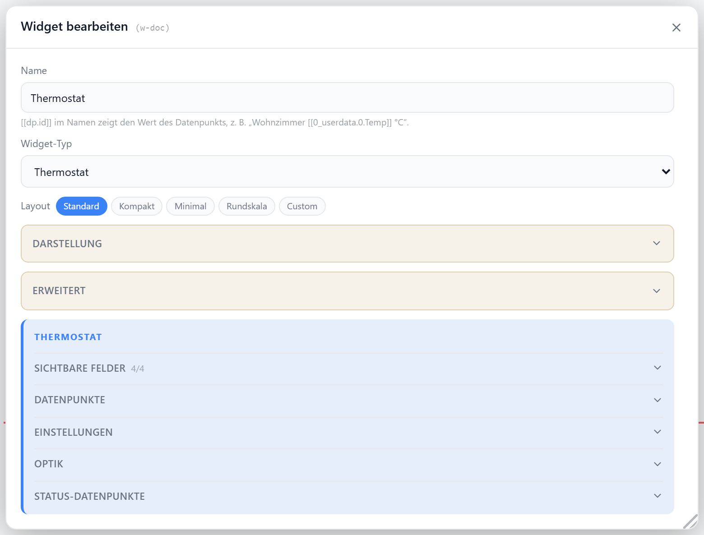
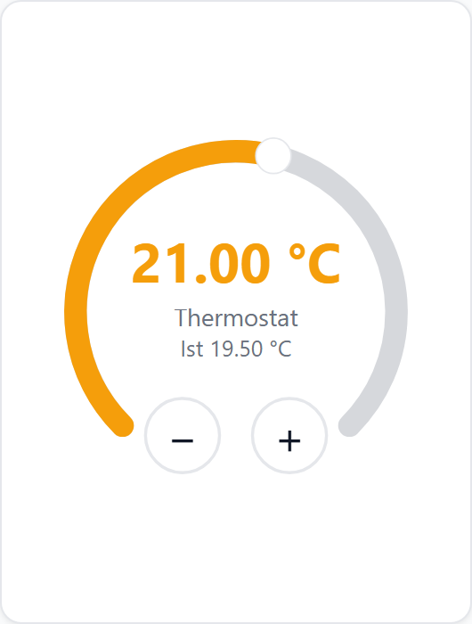

# Thermostat

Stellt die Soll-Temperatur per Plus/Minus-Tasten ein und zeigt optional die Ist-Temperatur an. Heiz-/Kühl-Status wird per Icon und Akzentfarbe dargestellt, im Default-Layout ergänzt durch einen Fortschrittsbalken.

## Datenpunkt

| Feld | Pflicht | Typ | |
| --- | --- | --- | --- |
| `datapoint` | ja | `number` | Soll-Temperatur |
| `actualDatapoint` | nein | `number` | Ist-Temperatur |

## Layouts

### Default
Anatomie: Titelzeile (Icon + Titel links, Heiz-/Kühl-Symbol rechts) · große Soll-Temperatur mit Ist-Wert darunter · Plus/Minus-Tasten rechts · Preset-Buttons unten. Für mittlere Zellen.

### Compact
Anatomie: eine Zeile — Icon · Titel · `Soll°C / Ist°C` · Minus/Plus. Für Listen mit vielen Thermostaten.

### Minimal
Anatomie: zentriert gestapelt — Icon · Soll-Temperatur · Ist-Temperatur · Minus/Plus · Preset-Buttons. Für sehr kleine Zellen.

### Rundskala
Anatomie: offener 270°-Bogen (`minTemp` … `maxTemp`) mit Griff am Soll-Wert · Soll-Temperatur, Titel und Ist-Wert zentriert im Ring · Minus/Plus-Tasten in der Bogenlücke · Preset-Buttons darunter. Der Bogen ist ziehbar — geschrieben wird erst beim Loslassen.

### Kreismenü
Runder Knopf mit Soll- und Ist-Temperatur; ein Tipp fächert −, die Schnellwahl (`presets`) und + im Kreis auf (#815). − und + lassen das Menü offen, der neue Sollwert steht in der Mitte.

| Geschlossen | Geöffnet |
| --- | --- |
|  |  |

### Custom
Icon, Soll-Wert (`value`), Ist-Wert (`actual`), Status (`status`) und Tasten (`btn-plus`/`btn-minus`) frei in einer Zellenmatrix platzieren — siehe [Custom-Layout](./custom-layout). Startet auf Wunsch aus dem bisherigen Layout ([Aus Layout übernehmen](./custom-layout#aus-layout-ubernehmen)); die Rundskala ist dafür die Komponente `dial`, die Schnellwahl `presets`.

## Einstellungen

Alle Optionen werden im Editor unter **Widget bearbeiten** gesetzt.

### Anzeige

| Option | Standard | |
| --- | --- | --- |
| `showTitle` | `true` | Titel anzeigen |
| `showIcon` | `true` | Icon anzeigen |
| `showSetpoint` | `true` | Soll-Temperatur anzeigen |
| `showActualTemp` | `true` | Ist-Temperatur anzeigen |
| `showControls` | `true` | Plus/Minus-Tasten anzeigen |
| `icon` | `Thermometer` | [Lucide-Icon](https://lucide.dev) |
| `iconSize` | `20` | px |
| `titleAlign` | `left` | `left` · `center` · `right` |
| `decimals` | globale Vorgabe | Nachkommastellen |

### Steuerung

| Option | Standard | |
| --- | --- | --- |
| `minTemp` | `10` | untere Grenze der Soll-Temperatur |
| `maxTemp` | `30` | obere Grenze der Soll-Temperatur |
| `step` | `0.5` | Schrittweite je Tastendruck |
| `showPresets` | `true` | Preset-Buttons anzeigen |
| `presets` | `[18,20,22,24]` | Soll-Temperatur-Presets (°C) |

### Schwellwerte

Färbt die angezeigte Temperatur abhängig vom Ist- (bzw. Soll-)Wert.

| Option | Standard | |
| --- | --- | --- |
| `colorThresholds` | — | Liste aus `[Schwelle, Farbe]`, z. B. `[[18,"#00f"],[30,"#f00"]]` |

### Rundskala

Nur im Layout **Rundskala**.

| Option | Standard | |
| --- | --- | --- |
| `dialColor` | — | feste Bogenfarbe (leer = Heiz-/Kühl-Akzent) |
| `dialColorThresholds` | — | Liste aus `[Schwelle, Farbe]`, gegen den **Soll**-Wert geprüft; schlägt `dialColor` |
| `dialThickness` | `11` | Bogenbreite |
| `dialTrackColor` | — | Farbe der ungefüllten Skala |

### Kreismenü (Layout `circle`)

| Option | Standard | |
| --- | --- | --- |
| `circleDirection` | `auto` | `auto` (Vollkreis, wenn er ins Fenster passt, sonst Halbkreis mit dem meisten Platz) · `full` · `top` · `right` · `bottom` · `left` |
| `circleOrder` | — | Reihenfolge der Einträge: `minus`, `plus`, `preset-<Wert>` (z. B. `preset-21.5`). Vollkreis ab oben im Uhrzeigersinn, Halbkreis von links bzw. oben. Nicht genannte Einträge folgen in Standardreihenfolge |
| `circleIcon` | — | Icon im runden Knopf; leer = Widget-Icon (`icon`), ohne beides ein Thermometer |
| `circleTriggerSize` | — | fester Durchmesser des runden Knopfs in px (40–396), höchstens Widget-Größe; leer = füllt das Widget (Regler ganz rechts) |
| `circleItemSize` | `48` | Durchmesser der Einträge in px (32–96) |
| `circleKeepOpen` | `false` | Menü bleibt nach einer Auswahl offen |
| `circleShade` | `true` | Seite hinter dem Menü abdunkeln |

### Status-Datenpunkte

Optionale Batterie- und Erreichbarkeits-DPs werden als kleine Badges eingeblendet (Abschnitt **Status-Datenpunkte** im Dialog). Eigene Symbole und Reihenfolge: [Status-Symbole](./status-symbole).

| Status-DP | Badge | Auto-Erkennen |
|---|---|---|
| Batterie | Batterie grün / orange | `LOWBAT`, `LOW_BAT` … |
| Erreichbarkeit | Funk grün / rot | `UNREACH` … |
| Fenster | Fenster grün (zu) / orange (offen) | `WINDOW_OPEN_REPORTING`, `WINDOW_STATE`, `window_open` |

**Werte (kommagetrennt):** Batterie „schwach“ `true,1`, Erreichbarkeit `true,1`, Fenster „offen“ siehe unten — vorausgefüllt, leeres Feld = Standard.

**Fenster – Werte für „offen“:** leer = `true,1,2,open,tilted` (gekippt zählt als offen). Mit **Nur bei Alarm** erscheint jeder Badge nur, solange er selbst Alarm meldet (Batterie schwach, nicht erreichbar, Fenster offen).

**Farbe bei Alarm:** je Badge eigener Farbwähler (Batterie schwach, nicht erreichbar, Fenster offen); vorausgewählt ist die Theme-Farbe, ↺ setzt sie zurück.
