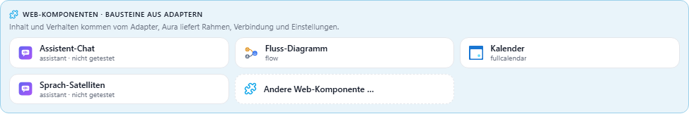
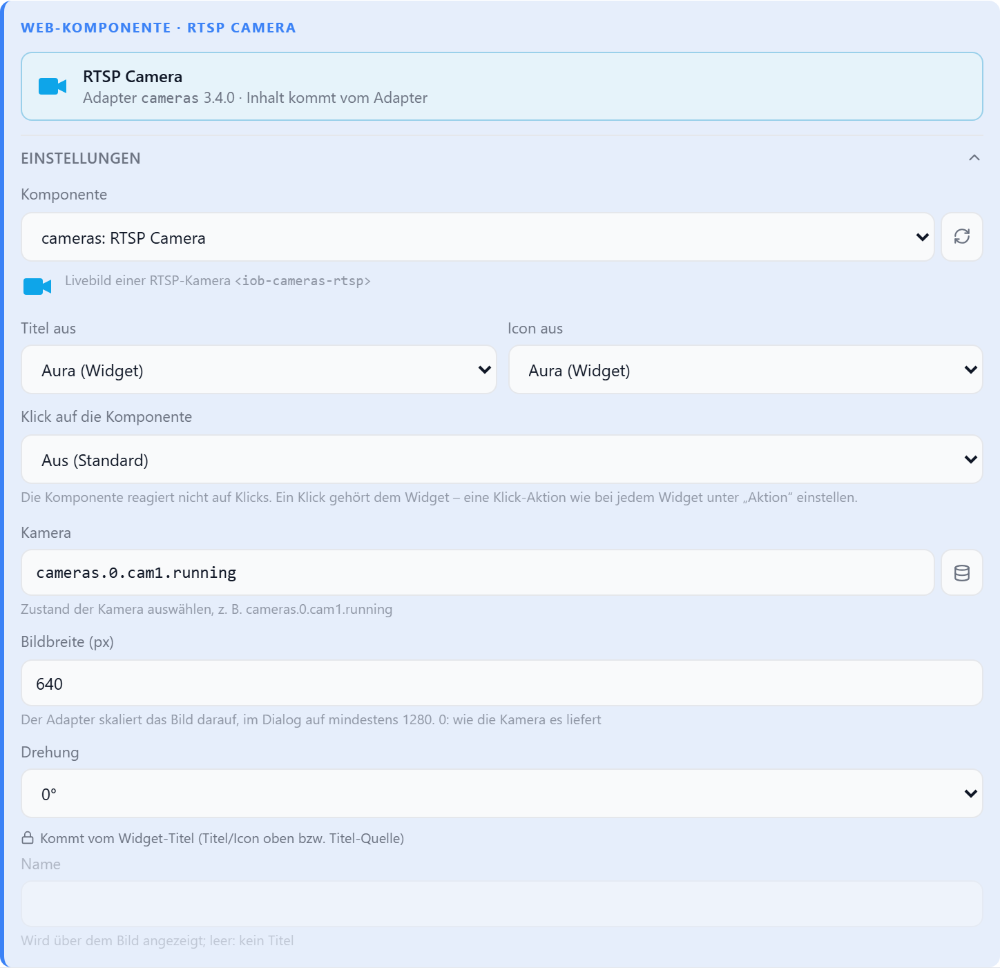
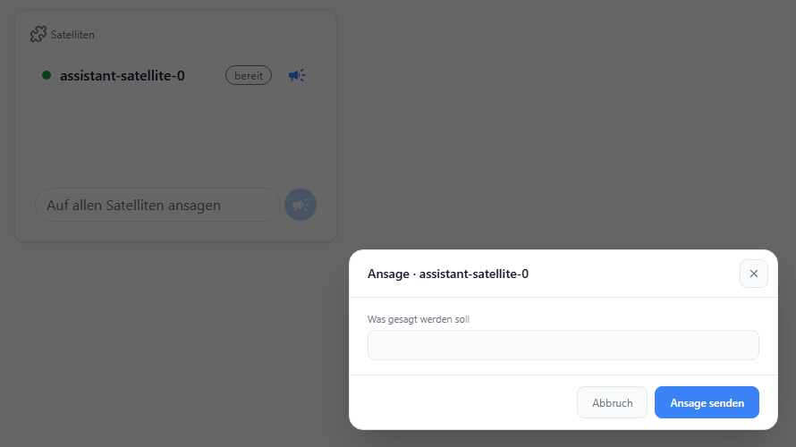

# Web-Komponente

Bettet eine **ioBroker-Web-Komponente** eines installierten Adapters ein — zum Beispiel das
Fluss-Diagramm des Adapters `flow`. Web-Komponenten sind Bausteine, die ein Adapter selbst
mitbringt und die in Aura, vis-2 und devices gleich aussehen und funktionieren
([`@iobroker/web-components`](https://github.com/ioBroker/web-components)).

Die Komponente liest und schreibt ihre Datenpunkte selbst. Aura gibt ihr die Verbindung zu
ioBroker, die gewählten Einstellungen, die Farben und die Schrift des aktiven Themes, den
Bearbeitungsmodus und Dialoge im Aura-Stil.

## Hinzufügen

„Web-Komponente“ ist **ein** Widget-Typ. Im Dialog **Neues Widget** steht er in einer eigenen,
farbig abgesetzten Gruppe **Web-Komponenten** (auch als Rubrik oben wählbar) — mit einem Eintrag
je Komponente:

| Eintrag | Bedeutung |
| --- | --- |
| Name + Adapter (z. B. **Kalender** · `fullcalendar`) | Komponente eines installierten Adapters, mit Aura getestet |
| … · **nicht getestet** | automatisch aufgenommen, noch nicht mit Aura geprüft — funktioniert meist, ohne Gewähr |
| … · **Adapter fehlt** (ausgegraut) | Adapter nicht installiert oder zu alt — lässt sich trotzdem platzieren; die Komponente ist Aura bekannt oder steht im Repository (siehe unten) |
| **Andere Web-Komponente …** | der Typ ohne Vorauswahl, die Komponente wird in den Einstellungen gewählt |

Mit Aura getestet (auch ohne Adapter im Dialog): **Fluss-Diagramm** (`flow` ab 0.2.0),
**Kalender** (`fullcalendar` ab 3.4.1), **RTSP Camera** und **Snapshot Camera** (`cameras` ab 3.4.0). Die Suche findet Komponenten auch über den Adapter-Namen
oder „Web-Komponente“. Ein neues Widget bekommt die Größe, die die Komponente für sich angibt.

Im Dialog **Widget bearbeiten** steht der Typ in der Liste unter **Web-Komponenten (aus
Adaptern)**. Im Einstellungsteil **Web-Komponente · …** zeigt oben eine Karte Komponente, Adapter
und Version.

Angeboten wird, was ein Adapter in seiner `io-package.json` unter `common.webComponents`
anmeldet. Nach der Installation oder einem Update eines Adapters die Seite neu laden — oder in den
Einstellungen mit **↻** neben der Auswahl **Komponente** neu einlesen. Dort lässt sich auch auf eine
andere Komponente umstellen. Nach einem Neustart von ioBroker liest Aura die Liste selbst neu; fehlt
dabei noch eine Komponente (Upload läuft), versucht Aura es eine Minute lang alle 10 s erneut.

**Noch nicht installiert:** Auch Komponenten von Adaptern, die noch fehlen, stehen im Dialog —
ausgegraut mit **Adapter fehlt**, mit Name und Bild. Aura liest sie aus den aktiven Repositories
(dieselben wie unter **Adapter** im Admin), sofern der Adapter dort die Kurzform seiner Komponenten
mitliefert (Name, Bild, Größe; ab `@iobroker/web-components` 0.8). Ein so platziertes Widget nennt
im Bearbeitungsmodus den Adapter und die Version, die installiert werden muss; danach zeigt es die
Komponente. Die Liste liest Aura höchstens alle zehn Minuten neu.

Eine **aktualisierte** Komponente, die bereits auf der Seite zu sehen ist, läuft bis zum
nächsten Neuladen der Seite in der alten Version weiter — ein Browser kann ein Element nicht
neu definieren. Danach lädt er die neue Version: Aura hängt die Adapterversion an die
Adressen von Manifest und Modul, damit keine alte Datei aus dem Browser-Cache kommt.

## Einstellungen

| Option | | |
| --- | --- | --- |
| `wcTag` | Komponente | Tag des Elements, z. B. `iob-flow-diagram` |
| `wcAdapter` | — | Adapter der Komponente, z. B. `flow`; nur wichtig, wenn zwei Adapter denselben Tag anbieten |
| `wcSettings` | Einstellungen der Komponente | `{ schlüssel: wert }` — welche Felder es gibt, legt die Komponente fest |
| `wcTitleSource` | Titel aus | `aura` (Standard) = Widget-Titel · `component` = Name, den die Komponente meldet |
| `wcIconSource` | Icon aus | `aura` (Standard) = Widget-Icon · `component` = Bild der Komponente bzw. ihres Manifests |
| `wcClick` | Klick auf die Komponente | `off` · `component` — siehe [Klick](#klick) |

Unter der Auswahl zeigt der Editor die Einstellungen der gewählten Komponente: Textfelder,
Zahlen, Schalter, Farben, Auswahllisten, Datenpunkte, Objekte und Adapter-Instanzen — so, wie
sie die Komponente beschreibt. Gespeichert wird nur, was vom Standard abweicht.

Manche Auswahllisten kennt erst der Adapter, etwa seine Orte, Geräte oder Diagramme. Dann holt
der Editor die Einträge beim Öffnen von der Instanz und holt sie neu, sobald sich eine Einstellung
ändert, von der die Liste abhängt (zum Beispiel die gewählte Instanz). Liefert die Instanz keine
Liste, etwa weil sie gestoppt ist, erscheint ein Textfeld mit Hinweis; der Wert lässt sich dann
von Hand eintragen.

## Titel und Icon

Titel und Icon zeichnet immer Aura in der Titelzeile des Widgets (`showTitle`, `showIcon`) — die
Komponente nie einen zweiten Titel darüber.

| Feld der Komponente | im Editor | übernimmt |
| --- | --- | --- |
| Text-Feld `title` (z. B. **Name** der Kameras) | ausgegraut mit Grund | Widget-Titel |
| **Bei Klick groß öffnen** (Fluss-Diagramm) | ausgegraut mit Grund | **Vollbild-Knopf** unter **Darstellung** |

| Titel aus / Icon aus | Titel | Icon |
| --- | --- | --- |
| **Aura (Widget)** | Widget-Titel | Widget-Icon |
| **Komponente** | Name, den die Komponente meldet (z. B. Kameraname aus dem Adapter); sonst Widget-Titel | Bild, das die Komponente meldet; sonst Bild aus dem Manifest; sonst Widget-Icon |

Stand in einem älteren Widget noch ein Name in den Einstellungen der Komponente, bietet der Editor
**Als Widget-Titel übernehmen** oder **Verwerfen** an.

## Klick

| Klick auf die Komponente | Verhalten |
| --- | --- |
| **Aus** (Standard) | Die Komponente bekommt weder Klicks noch Tasten. Ein Klick gehört dem Widget: es gilt seine **Aktion** wie bei jedem Widget — ohne Aktion passiert nichts. |
| **Komponente** | Die Komponente bedient sich selbst (Knöpfe, eigener Dialog). Eine **Aktion** des Widgets bleibt still. Nötig für bedienbare Komponenten wie Kalender oder Fluss-Diagramm. |

## Verhalten

- **Navigation:** Will die Komponente zu einer anderen Ansicht springen, öffnet Aura den Tab
  mit diesem Namen, Slug oder dieser ID — zuerst im aktiven Bereich, dann in den übrigen
  Bereichen des Layouts. Im Bearbeitungsmodus wird nicht gesprungen.
- **Dialoge:** Öffnet die Komponente einen Dialog, zeigt Aura ihn wie ein eigenes Popup — siehe
  [Dialoge](#dialoge).
- **Nicht installiert:** Fehlt die Komponente (Adapter entfernt), bleibt das Widget im
  Dashboard leer; im Bearbeitungsmodus steht ein Hinweis.
- **Größe:** Die Komponente füllt die ganze Widget-Fläche.
- **Datenpunkt-Muster:** Abonniert eine Komponente Datenpunkte mit `*` (z. B. alle Zustände
  unter `assistant-satellite.0.*`), bekommt sie jede Änderung eines passenden Datenpunkts
  sofort mit — ohne regelmäßig neu zu suchen.

## Dialoge

Manche Komponenten fragen in einem Dialog nach (z. B. Grenzwerte) oder zeigen Details in einem
größeren Fenster (z. B. den Verlauf einer Batterie). Aura öffnet diese Dialoge im eigenen Stil —
nicht als Fenster des Browsers:

- **Ein Popup des Widgets:** Der Dialog ist dasselbe Popup wie bei der **Aktion** des Widgets —
  dessen Popup-Optionen gelten (Breite, Höhe, Vollbild, Titel ausblenden, Hintergrund, Abdunklung,
  Innenabstand), sonst die
  [globalen Popup-Einstellungen](../einstellungen/popups#globale-popup-einstellungen).
  Automatisch schließen gilt hier nicht — ein Formular verschwindet nicht beim Ausfüllen.
- **Formular:** Fragt die Komponente nach Werten, zeigt Aura dieselben Felder wie im
  Einstellungs-Editor des Widgets (Text, Zahl, Schieberegler, Schalter, Farbe, Auswahl,
  Datenpunkt, Instanz) mit **Abbruch** und **OK** — bzw. den Beschriftungen, die die
  Komponente mitgibt. Titel und Beschriftungen erscheinen in der Sprache des Frontends.
- **Inhalt der Komponente:** Zeichnet die Komponente den Inhalt selbst, setzt Aura ihn in den
  Rahmen; er bekommt die Farben des Themes. Die Komponente schließt den Dialog selbst (z. B. mit
  einem eigenen **Fertig**-Knopf).
- **Abbrechen:** Schließen-Knopf, Tippen neben den Dialog oder `Esc` schließen ihn, ohne etwas
  zu übernehmen.
- **Größe:** Breite/Höhe des Widget-Popups, sonst die der Komponente (ohne Angabe 480 px); nie
  größer als der Bildschirm abzüglich des üblichen Popup-Rands.
- Pro Widget ist immer nur ein Dialog offen. Liegt das Widget in einem Popup, öffnet sich der
  Dialog darüber; solange darin gearbeitet wird, schließt sich das Popup nicht von selbst.
- Im **Bearbeitungsmodus** öffnet sich kein Dialog.

## Für Adapter-Entwickler

Wie eine Komponente gebaut und angemeldet wird, beschreibt das Paket
[`@iobroker/web-components`](https://github.com/ioBroker/web-components). Damit Aura eine
Komponente schon vor der Installation anbietet, gehört die Kurzform ihres Manifests in
`common.webComponents` — sie entsteht beim Build mit `iob-web-components sync-io-package`. Aura setzt die
Eigenschaft `dialogs`: `openDialog()` der Basisklasse öffnet damit den Aura-Dialog, ein
Element-Dialog schließt mit dem Ereignis `iob-dialog-close`. Mit dem Ereignis `iob-header`
(`detail: { title?, icon? }`, `bubbles`, `composed`; bei jeder Änderung erneut) oder der
Eigenschaft `header` meldet eine Komponente Namen und Bild für die Titelzeile — Vorschlag, noch
nicht Teil des Pakets. Aura lädt das Manifest
und das Modul über `/adapter/<adapter>/…`; Komponenten mit React importieren
`/lib/esm/react-19.js` bzw. `react-18.js` — beides liefert Auras eigener Server (Port 8095)
aus, hinter der web-Erweiterung (`/aura/`) der web-Adapter.
